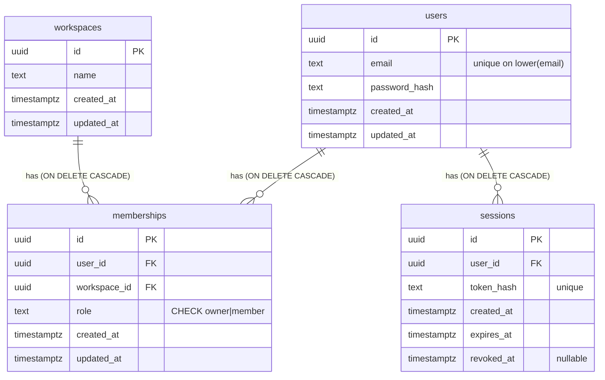
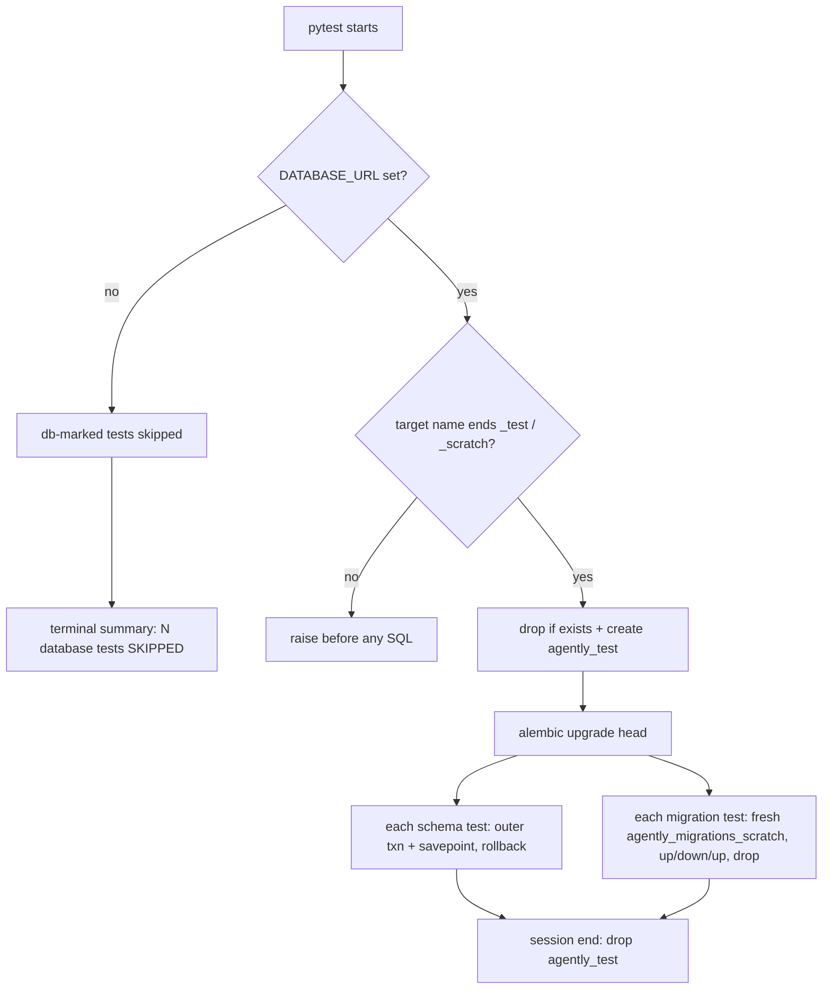

# Database and Migrations (Slice 1.1) - Plan

## Goal Capsule

- **Objective:** A developer can take an empty PostgreSQL database to Agently's current identity schema (users, workspaces, memberships, sessions) with one command, roll it back, and rely on the database to enforce identity and tenancy rules — so Slice 1.2 (authentication) and Slice 1.3 (workspaces/roles) build on a tested foundation instead of inventing storage.
- **Means:** SQLAlchemy 2.x models, an Alembic migration history, a request-scoped DB session, and a dev-only seed script (stack fixed by ADR-0002; KTD1–KTD9).
- **Product authority:** `AGENT_BUILD_GUIDE.md` Slice 1.1 and its Definition of Done, `docs/MASTER_PRD.md` (AUTH-*, WS-*, DATA-1), ADR-0002, ADR-0003, then this plan. Authentication endpoints, workspace APIs, and role enforcement are not active scope.
- **Execution profile:** one PR / one slice commit on `main` per the build guide's commit policy; units are ordered by dependency and land together.
- **Stop conditions:** stop and ask the owner if the `agently` role cannot create databases, if any fixture would need to touch a database not ending in `_test` or `_scratch`, or if a migration cannot downgrade cleanly.
- **Who finishes:** the implementing agent runs the Verification Contract, updates `PROJECT_STATUS.md`, commits, and pushes per `AGENT_BUILD_GUIDE.md`.
- **Open blockers:** None. Local PostgreSQL is reachable (`/api/health/ready` reports `database: ok` as of 2026-11-21).

---

## Product Contract

Product Contract preservation: changed: added R17, R18 — owner's safety additions confirmed at plan scoping (drop guard, loud skip summary); R16 unchanged.

### Summary

Add the backend's database layer and the first Alembic migration creating users, workspaces, memberships, and sessions, with UUID keys, timezone-aware timestamps, case-insensitive unique emails, hashed-only session tokens, and hard-delete cascade rules. Migration and constraint tests run against a throwaway database the test suite creates and drops itself.

### Problem Frame

Every Phase 1 feature needs durable storage for people and tenants, but the backend today only opens an engine to answer a readiness ping: there are no models, no migration history, and no per-request session handling (`backend/app/core/database.py`). Without a migration history, schema state would live in whatever someone ran by hand, which the build guide forbids. The tenancy rules the PRD depends on — one user in many workspaces, one role per membership, a deleted workspace leaving nothing behind — need to be enforced by the database itself so later slices cannot accidentally bypass them.

### Requirements

**Connection lifecycle**

- R1. Request handlers obtain a database session that is opened per request and always closed afterwards, committing or rolling back explicitly; the existing readiness check keeps working unchanged.
- R2. Database credentials never appear in logs, error responses, or test output, including on connection and migration failures.

**Schema**

- R3. A user has an email, a password hash, and created/updated timestamps; emails are unique regardless of letter case.
- R4. A workspace has a name and created/updated timestamps.
- R5. A membership links one user to one workspace with a role of `owner` or `member`; a user can hold at most one membership per workspace and can belong to many workspaces.
- R6. A session belongs to one user and stores only a hash of its token, never the raw token, plus `expires_at` and a nullable `revoked_at`; the token hash is unique and indexed for lookup.
- R7. All four tables use UUID primary keys.
- R8. Every timestamp column (`created_at`, `updated_at`, `expires_at`, `revoked_at`) is timezone-aware.

**Deletion**

- R9. Deleting a workspace permanently removes its memberships.
- R10. Deleting a user permanently removes their sessions and memberships but not the workspaces they belonged to.

**Migrations**

- R11. A single command upgrades an empty database to the latest revision, and the initial revision downgrades cleanly back to empty.
- R12. The migration history matches the models: no autogenerate drift remains after upgrading to head.

**Seed data**

- R13. A clearly labelled, manually run script creates one demo user, one workspace, and an owner membership for local development; it refuses to run when the environment is production and is safe to run twice.

**Testing**

- R14. Migration and constraint tests create their own throwaway database (e.g. `agently_test`), run against it, and drop it afterwards, with no manual setup step from the owner.
- R15. Tests prove: upgrade on an empty database, downgrade and re-upgrade, case-insensitive email uniqueness, membership uniqueness, role restricted to `owner`/`member`, foreign keys rejecting orphans, and the cascade behaviour in R9–R10.
- R16. Existing tests keep passing without a database, and CI-style runs without `DATABASE_URL` skip the database tests with a clear reason instead of failing.
- R17. Test fixtures refuse to create, drop, or recreate any database whose name does not end in `_test` (or `_scratch` for the migration-test database); the development `agently` database cannot be dropped by the test suite, and a test proves the guard.
- R18. When database tests skip because `DATABASE_URL` is unset, the pytest run ends with a one-line summary naming how many database tests were skipped and why (e.g. `12 database tests SKIPPED: DATABASE_URL not set`), and `PROJECT_STATUS.md` records database tests as PASS only when they actually ran.

### Acceptance Examples

- AE1. **Covers R3.** With `alice@example.com` registered, inserting `Alice@Example.com` fails on the uniqueness constraint.
- AE2. **Covers R5.** Inserting a second membership for the same user and workspace fails; the same user joining a different workspace succeeds.
- AE3. **Covers R9, R10.** Deleting a workspace removes its memberships and leaves its users intact; deleting a user removes their sessions and memberships and leaves the workspace in place.
- AE4. **Covers R11.** On a fresh empty database, upgrade-to-head then downgrade-to-base leaves no Agently tables behind; upgrading again succeeds.
- AE5. **Covers R13.** Running the seed script with the environment set to production exits with an error and writes nothing; running it twice in development leaves exactly one demo user.
- AE6. **Covers R17.** Asking the test database helper to drop or recreate `agently` (or any name not ending in `_test`/`_scratch`) raises an error before any SQL is sent.
- AE7. **Covers R18.** With `DATABASE_URL` unset, `pytest` exits successfully and its terminal summary includes a line like `N database tests SKIPPED: DATABASE_URL not set`.

### Key Decisions

- **Hard delete with database-level cascades.** Rows are removed immediately; no `deleted_at` columns and no purge job. This is the deletion behaviour DATA-1 requires to be documented. Governs R9, R10. (session-settled: user-directed — chosen over soft delete with later purge and soft delete only: simplest, matches what users expect from "delete", and no lingering data or query filters.)
- **Case-insensitive unique email.** Governs R3. (session-settled: user-approved — proposed with the tradeoff shown and confirmed: `Bob@x.com` and `bob@x.com` are one account.) Mechanism: KTD2.
- **UUID primary keys on all four tables.** Governs R7. (session-settled: user-directed — chosen over serial integers: IDs appearing in URLs must not be guessable.)
- **Session rows store only the token hash, with `expires_at` and `revoked_at`.** Governs R6. (session-settled: user-directed — chosen over storing the raw token: a database leak must not yield usable sessions.) ADR-0003 says logout deletes the session row; `revoked_at` adds a non-destructive revocation option. Which one logout uses is decided in Slice 1.2, and ADR-0003 is updated if it changes.
- **Timezone-aware timestamps everywhere.** Governs R8. (session-settled: user-directed — chosen over naive timestamps: avoids ambiguity across server and client time zones.)
- **Self-managing test database.** Governs R14. (session-settled: user-directed — chosen over a manually created test database: the `agently` role has `CREATEDB`, so no owner setup step.)
- **Name-suffix drop guard.** Governs R17. (session-settled: user-directed — chosen over trusting fixture configuration alone: the dev database must be impossible to drop from tests.)
- **Loud skip summary.** Governs R18. (session-settled: user-directed — chosen over pytest's default skip reporting: a skip must never be mistaken for a pass.)
- **Sessions table ships in this slice** even though Slice 1.2 is its first consumer, keeping all identity tables in one initial migration as `PROJECT_STATUS.md` lists.

### Scope Boundaries

**Deferred to later slices**

- Preventing ownerless workspaces ("last owner cannot leave or delete their account") — Slice 1.3; recorded in `PROJECT_STATUS.md` as a known gap.
- Registration, login, logout, `/me`, and rate limiting — Slice 1.2.
- Workspace APIs, role changes, and permission enforcement — Slice 1.3.
- pgvector extension and embedding tables — Phase 4.
- Usage, audit, and job tables — their own slices (ADR-0004 for jobs).

**Outside this slice**

- Any new HTTP route.
- Email verification and password reset (ADR-0003: not built until an email service exists).

**Considered and not built**

- A database trigger to maintain `updated_at` — the ORM maintains it (KTD4); revisit if raw-SQL writes become a real path.
- `citext` extension — rejected for KTD2; revisit only if case-insensitive matching is needed on more than email.
- Async SQLAlchemy — the app and tests are sync today; switching is a separate decision if a hot path needs it.

### Deferred to Follow-Up Work

- A CI workflow running backend tests against a PostgreSQL service container (no `.github/workflows/` exists yet). R16/R18 keep the suite honest until then.

---

## Planning Contract

### Key Technical Decisions

- KTD1. **Sync SQLAlchemy 2.x with a request-scoped session dependency.** A `sessionmaker` bound to the existing cached engine; a FastAPI dependency yields a session, rolls back on exception, and always closes. It never commits on its own — service code commits explicitly. Matches the current sync app and `TestClient`. Governs R1. (session-settled: user-approved — explicit commits confirmed at plan scoping over auto-commit-on-success.)
- KTD2. **Case-insensitive email via a functional unique index on `lower(email)`.** No extension install needed (the `agently` role is not a superuser). Emails are stored as entered; lookups (Slice 1.2) must compare `lower(email) = lower(:input)` so the functional index is used. Governs R3. (session-settled: user-approved — chosen over `citext` at plan scoping: avoids installing a PostgreSQL extension.)
- KTD3. **UUIDs generated by PostgreSQL's built-in `gen_random_uuid()`** as the server default (PG 13+, so it works on the PG 17 Docker image and native PG 18), with a Python-side `uuid4` default so objects have IDs before flush. Governs R7. (session-settled: user-approved — confirmed at plan scoping.)
- KTD4. **`created_at` defaults to `now()` in the database; `updated_at` is set on insert and refreshed by the ORM on update** (no trigger). Governs R8. (session-settled: user-approved — app-managed `updated_at` confirmed at plan scoping; raw SQL updates will not bump it.)
- KTD5. **Constraint naming convention on the shared `MetaData`** (`pk_`, `fk_`, `uq_`, `ix_`, `ck_` patterns) so Alembic autogenerate and downgrades reference stable names.
- KTD6. **Role as a `CHECK (role IN ('owner','member'))` constraint on a text column**, not a PostgreSQL enum type. Adding a role later is a one-line constraint swap instead of an `ALTER TYPE` migration; the PRD expects new roles later.
- KTD7. **Alembic receives the database URL from application settings, never from `alembic.ini`.** `env.py` builds the engine from `get_settings().database_url` and hands Alembic a connection, which avoids ConfigParser `%`-interpolation breaking on passwords and keeps credentials out of committed config. Tests pass their own connection through Alembic's config attributes. Governs R2.
- KTD8. **Test database lifecycle in `conftest.py`.** Derive the test URL from `DATABASE_URL` by replacing the database name; connect to the `postgres` maintenance database with autocommit to `DROP DATABASE IF EXISTS … WITH (FORCE)` then `CREATE DATABASE`. Session-scoped `agently_test` is upgraded to head once, and each schema test runs inside an outer transaction with savepoints that is rolled back. Migration tests use a function-scoped `agently_migrations_scratch` database so each starts truly empty. Every create/drop goes through one helper that enforces the R17 suffix guard before sending SQL. Governs R14, R15, R17.
- KTD9. **Skips via a `db` marker plus a `pytest_terminal_summary` hook.** Database tests carry `@pytest.mark.db`; `pytest_collection_modifyitems` adds a skip marker to them when the resolved setting is unset or empty (settings also read `backend/.env`, so an empty `DATABASE_URL=""` environment value must count as unset), and the summary hook counts those skips and prints the one-line notice. Governs R16, R18.

### High-Level Technical Design

Schema shape (authoritative relationships; column details live in U2):



Membership uniqueness is a composite unique constraint on `(user_id, workspace_id)`; it also serves user→workspaces lookups, and a separate index on `workspace_id` serves workspace→members lookups.

Test database lifecycle:



### Assumptions

- The `agently` role keeps `CREATEDB` and can connect to the `postgres` maintenance database (true for the README setup).
- `DROP DATABASE … WITH (FORCE)` is available (PG 13+), so a leftover connection from a crashed run cannot block recreation.

### Output Structure

```text
backend/
  alembic.ini
  migrations/
    env.py
    script.py.mako
    versions/0001_identity_tables.py
  app/core/database.py          (extended)
  app/models.py                 (imports every model for Alembic metadata)
  app/modules/identity/models.py
  app/modules/workspaces/models.py
  scripts/seed_dev.py
  tests/conftest.py
  tests/db_utils.py
  tests/test_db_guard.py
  tests/test_migrations.py
  tests/test_schema_constraints.py
  tests/test_db_session.py
  tests/test_seed_dev.py
docs/DATABASE_DESIGN.md
```

---

## Implementation Units

### U1. Declarative base and request-scoped session

- **Goal:** Give the app one declarative base with naming conventions and a per-request session dependency, without changing readiness behaviour.
- **Requirements:** R1, R2; KTD1, KTD5.
- **Dependencies:** none.
- **Files:** modify `backend/app/core/database.py`; create `backend/tests/test_db_session.py` (DB-backed scenarios carry the `db` marker from U4).
- **Approach:**
  1. Add a `Base` (SQLAlchemy 2 `DeclarativeBase`) whose `MetaData` carries the KTD5 naming convention.
  2. Add a cached session factory bound to `get_engine()`; keep `get_engine` and `check_database` signatures unchanged so `test_health.py` keeps passing.
  3. Add a `get_db` dependency: yield session, roll back on exception, always close; no implicit commit.
- **Patterns to follow:** `lru_cache` + `cache_clear` pattern in `backend/app/core/database.py` and `reset_caches` fixture in `backend/tests/test_health.py`.
- **Test scenarios:**
  - `get_db` closes the session after normal completion (no commit issued; an uncommitted insert is not visible from a second connection).
  - `get_db` rolls back when the handler raises, and the exception propagates.
  - With `DATABASE_URL` unset, requesting `get_db` raises `DatabaseNotConfiguredError` rather than a driver error, and the readiness endpoint still reports `not_configured`.
- **Verification:** existing 9 backend tests still pass; new session tests pass against the test DB.

### U2. Identity and workspace models

- **Goal:** Model users, workspaces, memberships, and sessions exactly as the ERD describes.
- **Requirements:** R3–R10; KTD2, KTD3, KTD4, KTD6.
- **Dependencies:** U1.
- **Files:** create `backend/app/modules/identity/__init__.py`, `backend/app/modules/identity/models.py` (User, Session), `backend/app/modules/workspaces/__init__.py`, `backend/app/modules/workspaces/models.py` (Workspace, Membership), `backend/app/models.py`.
- **Approach:**
  1. All PKs `UUID` with KTD3 defaults; all timestamps `DateTime(timezone=True)` per KTD4.
  2. Users: functional unique index on `lower(email)` (KTD2); `password_hash` not nullable.
  3. Memberships: FKs to users and workspaces with `ondelete="CASCADE"`; composite unique `(user_id, workspace_id)`; index on `workspace_id`; role check constraint (KTD6).
  4. Sessions: FK to users with `ondelete="CASCADE"`; unique `token_hash`; `expires_at` not nullable; `revoked_at` nullable. Name the class so it cannot be confused with SQLAlchemy's `Session` (e.g. `UserSession` mapped to table `sessions`).
  5. ORM relationships use `passive_deletes=True` so the database, not the ORM, performs cascades (keeps R9/R10 true for raw SQL deletes too).
  6. `app/models.py` imports every model module so `Base.metadata` is complete for Alembic.
- **Test scenarios:** covered by U4's constraint tests against the migrated schema (models alone have no behaviour to test without the schema).
- **Verification:** importing `app.models` registers exactly four tables on `Base.metadata`.

### U3. Alembic setup and initial migration

- **Goal:** One-command upgrade/downgrade of the identity schema, with no drift from the models.
- **Requirements:** R2, R11, R12; KTD5, KTD7.
- **Dependencies:** U2.
- **Files:** create `backend/alembic.ini`, `backend/migrations/env.py`, `backend/migrations/script.py.mako`, `backend/migrations/versions/0001_identity_tables.py`; modify `README.md` (migration commands).
- **Approach:**
  1. `alembic.ini` has `script_location = migrations` and **no** `sqlalchemy.url`.
  2. `env.py` (KTD7): if a connection is supplied via config attributes, use it; otherwise build the engine from settings and fail with a credential-free message when `DATABASE_URL` is unset. `target_metadata = Base.metadata` from `app.models`; `compare_type=True`.
  3. Generate the initial revision with autogenerate, then hand-review it: confirm the functional `lower(email)` index, check constraint, cascades, and `gen_random_uuid()` defaults are present; write an explicit `downgrade` that drops tables in dependency order.
  4. Use a readable revision id (`0001`) via `--rev-id`.
  5. README: add `.venv\Scripts\alembic upgrade head` / `downgrade base` under Setup and Tests.
- **Patterns to follow:** credential-safe logging in `check_database` (log exception type only).
- **Test scenarios:** in U4 (`test_migrations.py`).
- **Verification:** `alembic upgrade head` against the dev `agently` database succeeds; `alembic check` reports no new operations.

### U4. Test database harness, guard, loud skips, and schema tests

- **Goal:** Self-managing, guarded test databases and tests that prove every schema rule.
- **Requirements:** R2, R11, R12, R14–R18; AE1–AE4, AE6, AE7; KTD8, KTD9.
- **Dependencies:** U3.
- **Files:** create `backend/tests/db_utils.py`, `backend/tests/conftest.py`, `backend/tests/test_db_guard.py`, `backend/tests/test_migrations.py`, `backend/tests/test_schema_constraints.py`; modify `backend/pyproject.toml` (register the `db` marker).
- **Approach:**
  1. `db_utils.py`: derive a sibling URL by swapping the database name (`URL.set(database=…)`); `recreate_database(name)` / `drop_database(name)` call a single `assert_disposable_name(name)` first, which raises unless the name ends in `_test` or `_scratch` (R17). The guard runs before any connection is opened.
  2. `conftest.py`: `db` marker skip logic and terminal summary hook (KTD9); session-scoped `test_engine` fixture that recreates `agently_test`, runs Alembic upgrade head through the connection attribute, yields, then drops the database; function-scoped `db_session` with outer transaction + savepoint rollback; function-scoped `scratch_engine` for `agently_migrations_scratch`.
  3. Tests never read or write the dev `agently` database; the derived names are fixed constants, not configurable from env.
  4. Make sure all `db_utils` errors and logs render URLs with the password hidden (`render_as_string(hide_password=True)`), never the raw URL.
- **Execution note:** write `test_db_guard.py` first and confirm it fails before the guard exists — it protects the owner's dev data.
- **Test scenarios:**
  - Covers AE6. `assert_disposable_name("agently")` raises; `drop_database("agently")` and `recreate_database("agently")` raise without opening a connection (assert by passing an unreachable URL and checking the guard error, not a connection error, is raised).
  - Names `agently_test` and `agently_migrations_scratch` pass the guard; `agently_test_backup`, `test`, and `my_test_db_prod` do not.
  - Covers AE4. On a fresh scratch database: upgrade to head creates exactly the four tables plus `alembic_version`; downgrade to base leaves none of the four tables (an empty `alembic_version` may remain); upgrading again succeeds.
  - After upgrade to head, Alembic's autogenerate comparison against `Base.metadata` returns no differences (R12).
  - Covers AE1. Inserting `Alice@Example.com` after `alice@example.com` raises an integrity error.
  - Covers AE2. Duplicate `(user, workspace)` membership raises; same user in a second workspace succeeds.
  - Membership with role `admin` raises a check-constraint error.
  - Membership or session referencing a non-existent user or workspace raises a foreign-key error.
  - Covers AE3. Deleting a workspace via SQL removes its memberships and keeps its users; deleting a user removes their sessions and memberships and keeps the workspace.
  - Duplicate `token_hash` raises; `revoked_at` may be null; `expires_at` may not.
  - Inserting a user without explicit id/timestamps yields a UUID id and timezone-aware `created_at`.
  - Covers AE7. A subprocess pytest run over a db-marked sample test with `DATABASE_URL=""` in its environment (overriding `backend/.env`) shows exit code 0 and a summary line matching `\d+ database tests SKIPPED: DATABASE_URL not set`.
  - Migration failure output (e.g. connecting with a bad password) does not contain the password (R2).
- **Verification:** full suite green with `DATABASE_URL` set; with it unset, non-DB tests pass and the skip summary prints; after the run, `agently_test` and `agently_migrations_scratch` no longer exist and the dev `agently` database is untouched.

### U5. Development seed script

- **Goal:** One safe, idempotent command to get a demo user and workspace locally.
- **Requirements:** R13; AE5.
- **Dependencies:** U3 (U4 for its tests).
- **Files:** create `backend/scripts/__init__.py`, `backend/scripts/seed_dev.py`, `backend/tests/test_seed_dev.py`; modify `README.md`.
- **Approach:**
  1. Module docstring and printed banner label it DEVELOPMENT ONLY.
  2. Refuse (non-zero exit, nothing written) when `settings.is_production`.
  3. Look up the demo user by lowercased email; create user (Argon2id hash via `argon2-cffi`, per ADR-0003), workspace, and owner membership in one transaction only if absent.
  4. The demo password is a fixed, obviously-fake dev value printed once; it is never read from `.env`.
  5. Expose a `seed(session)` function the tests call against `db_session`; `main()` wires settings and the real session.
- **Test scenarios:**
  - Covers AE5. With environment `production`, `main()` exits non-zero and no rows are written.
  - Covers AE5. Calling `seed` twice yields exactly one user, one workspace, one owner membership.
  - The stored password hash verifies with Argon2 against the demo password and is not equal to it.
- **Verification:** `.venv\Scripts\python -m scripts.seed_dev` against the dev database prints the banner and is a no-op on second run.

### U6. Documentation and status

- **Goal:** Record the deletion behaviour DATA-1 requires and the slice outcome.
- **Requirements:** R9, R10, R18; DATA-1.
- **Dependencies:** U1–U5.
- **Files:** create `docs/DATABASE_DESIGN.md`; modify `docs/SYSTEM_ARCHITECTURE.md` (link), `README.md`, `PROJECT_STATUS.md`.
- **Approach:**
  1. `DATABASE_DESIGN.md`: the four tables, keys, constraints, cascade/deletion rules (hard delete), timestamp and UUID conventions, the migration workflow, and the known ownerless-workspace gap pointing at Slice 1.3. Link to this plan rather than repeating rationale.
  2. `PROJECT_STATUS.md`: Slice 1.1 log entry using the existing table format; DB-backed rows say PASS only if they ran (R18), otherwise SKIPPED with the reason.
- **Test expectation:** none — documentation only.
- **Verification:** DATA-1's referenced doc exists and matches the migration.

---

## Verification Contract

| Gate | Command (from `backend/`, PowerShell) | Passes when |
|---|---|---|
| Unit + DB tests | `.venv\Scripts\python -m pytest` | all pass with `DATABASE_URL` set; no skip summary line printed |
| Skip honesty | `$env:DATABASE_URL=""; .venv\Scripts\python -m pytest` (empty value overrides `backend/.env`) | exit 0, non-DB tests pass, `N database tests SKIPPED: DATABASE_URL not set` printed |
| Lint | `.venv\Scripts\ruff check .` | clean |
| Format | `.venv\Scripts\ruff format --check .` | clean |
| Migrate dev DB | `.venv\Scripts\alembic upgrade head` then `alembic check` | upgrade succeeds; no pending operations |
| Rollback | `.venv\Scripts\alembic downgrade base` then `upgrade head` | both succeed on the dev DB |
| Readiness | `curl.exe http://localhost:8000/api/health/ready` | `{"status":"ready","checks":{"database":"ok"}}` |
| Frontend unaffected | `frontend: npm test`, `npm run lint`, `npm run typecheck` | unchanged results |

---

## Definition of Done

- Every R1–R18 is covered by a unit and, where behavioural, a passing test; AE1–AE7 each have a test.
- `AGENT_BUILD_GUIDE.md` Slice 1.1 test/verify list is satisfied: fresh-DB migration, from-previous-revision (base→0001), rollback, constraints and FKs, credentials not logged.
- No test touches the dev `agently` database; `agently_test` and `agently_migrations_scratch` are gone after the run.
- No secrets in the diff (`backend/.env` untracked); `git diff` limited to the files listed in the units.
- `docs/DATABASE_DESIGN.md` exists; `PROJECT_STATUS.md` has the Slice 1.1 entry with honest PASS/SKIPPED rows and still lists the Slice 1.3 ownerless-workspace gap.
- Abandoned-attempt code and debug output removed.
- Committed and pushed per the build guide.
