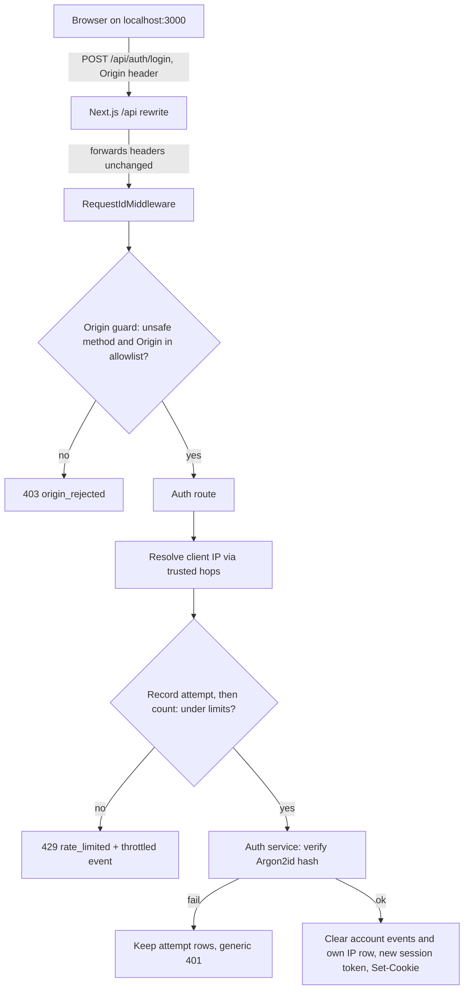
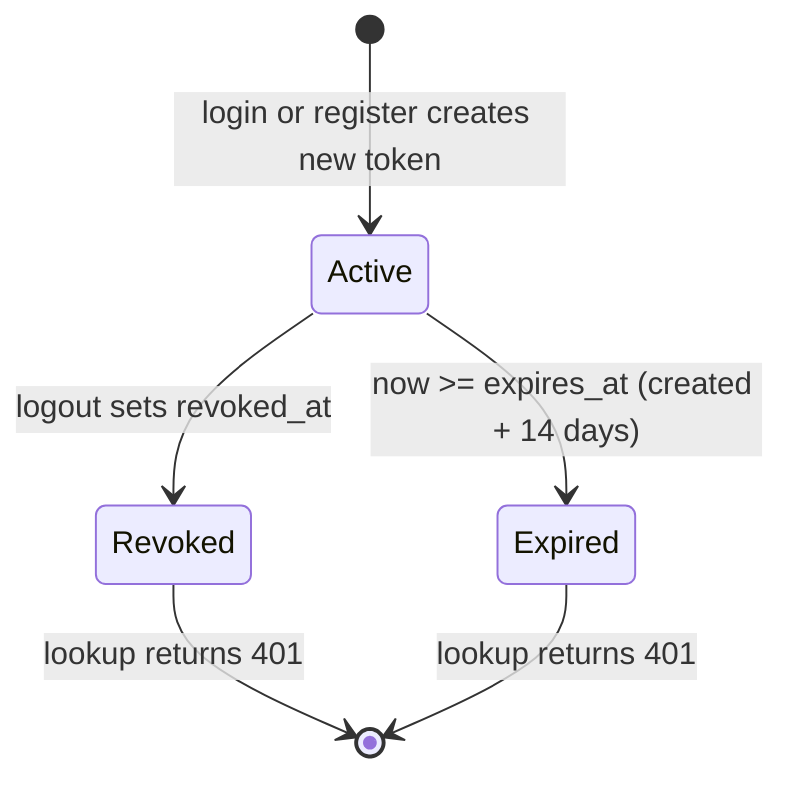

# Authentication (Slice 1.2) - Plan

## Goal Capsule

- **Objective:** A person can create an Agently account, sign in, stay signed in, and sign out, and the backend can trust who is calling on every private request. The auth surface passes the pre-launch audit's login-and-session checks (section 2) and its rate-limit and CSRF checks (6.1, 6.5) as shipped, so later slices build on it without a security catch-up pass.
- **Means:** server-side sessions per ADR-0003 (Argon2id passwords, opaque random token in a cookie, only its hash stored), PostgreSQL-backed throttling, an Origin allowlist, and three minimal Next.js pages (KTD1–KTD17).
- **Product authority:** `AGENT_BUILD_GUIDE.md` Slice 1.2 and its Definition of Done, `docs/MASTER_PRD.md` AUTH-1 to AUTH-4, ADR-0003 (amended by this plan's Key Decisions), the audit checks named above, then this plan. Workspace creation, role enforcement, and the dashboard shell (Slices 1.3 and 1.4) are not active scope.
- **Execution profile:** one slice on `main`, delivered as one commit set per the build guide's commit policy. Units are ordered by dependency and land together.
- **Stop conditions:** stop and ask the owner if a test would need to touch a database not named `agently_test` or `agently_migrations_scratch`, if `alembic check` reports drift after the `ROLES` change, if the Next.js rewrite turns out not to forward the browser's `Origin` header, or if a requirement turns out to need a new third-party service or credential.
- **Who finishes:** the implementing agent runs the Verification Contract, runs the saved browser check, updates `PROJECT_STATUS.md` with results and the re-run command, then commits and pushes per `AGENT_BUILD_GUIDE.md`.
- **Open blockers:** none. The deployment target is unknown, which leaves the client-IP source marked Suspected (R17) but does not block the slice.

---

## Product Contract

**Product Contract preservation:** changed: R16 and AE5 (two-tier account throttle, user-directed after review), R28 (the browser check is a saved repo script with a recorded re-run command), plus new R31 and R32. R28, R31 and R32 are user-directed additions made at plan confirmation. The brainstorm's Deferred-to-Planning questions are resolved in place by KTD2, KTD4, KTD5, KTD7, KTD10 and KTD9.

### Summary

Email-and-password register, login, logout, and current-user retrieval on top of the Slice 1.1 identity schema, using HttpOnly cookie sessions that the server can revoke. Login and signup are throttled per IP and per account using bounded shared storage. Every state-changing request passes a strict Origin check. Auth events are logged without secrets. Three plain pages and a saved, re-runnable browser script prove the cookie and CSRF behaviour end to end through the real `/api` proxy. The slice also closes two Slice 1.1 review items: the seed script refuses non-local databases and stops shipping a fixed password, and the unused `ROLES` constant is resolved.

### Problem Frame

Slice 1.1 created the `users` and `sessions` tables, but no one can sign in yet. Every later feature (workspaces, agents, chat, knowledge) needs the server to know who is calling. The repo is public and the product will hold private documents and model keys, so the first version of auth has to stand up to the owner's pre-launch audit. Fixing session handling after other features depend on it costs much more.

Two Slice 1.1 review findings become live risks once login exists. The seed script's demo password is written in a public repo, so it becomes a working credential on any database the script has run against. The script's only guard is `ENVIRONMENT=production`, so a staging database is not protected.

### Key Decisions

- **Server-side opaque sessions, not JWTs.** Logout must take effect immediately, and one backend gains nothing from stateless tokens. The token is random rather than signed, so no signing secret exists to leak or default. Governs R7, R8, R9.
- **Strict Origin check, stricter than ADR-0003.** A missing `Origin` header is rejected, not allowed, and login and register are covered even though they have no session yet (login CSRF). ADR-0003 is amended to match. Governs R14, R15. (session-settled: user-approved — chosen over ADR-0003's "check Origin only when present": a missing header must not bypass the check.)
- **`Secure` cookie flag in every environment except development.** This replaces ADR-0003's production-only rule. Governs R11. (session-settled: user-directed — chosen over Secure-in-production-only: test and staging must behave like production.)
- **Cookie settings and the Origin allowlist come from environment settings.** The production domain can then be added without a code change. Governs R12, R14.
- **Throttle with 429, never lock accounts.** A lockout would let an attacker lock any user out by guessing badly on purpose. Governs R16, R18. (session-settled: user-approved — chosen over account lockout.)
- **Account throttling has two tiers.** A low limit per account-and-IP pair stops guessing from one address without blocking the owner elsewhere. A higher per-account ceiling across all IPs bounds distributed guessing. A distributed attacker can still hit the ceiling, and that denial-of-login risk is accepted. Governs R16. (session-settled: user-directed — chosen over one strict cross-IP account limit: that limit lets anyone who knows an email block its owner.)
- **A successful login resets only the account counter.** Resetting the IP counter would let an attacker clear their IP limit by logging into their own account between guesses. Governs R31. (session-settled: user-directed — chosen over clearing both counters on success.)
- **Throttle storage is bounded and holds no plaintext emails.** Random-email spraying must not grow the table without limit. Governs R32. (session-settled: user-directed — chosen over keying by plaintext email with no cleanup.)
- **14-day absolute session lifetime, no sliding renewal.** A simple, predictable expiry. Governs R9. (session-settled: user-approved — chosen over sliding sessions.)
- **Password length 12 to 128 characters, no composition rules.** Follows NIST SP 800-63B. The upper cap bounds hashing cost. Governs R2. (session-settled: user-approved.)
- **Seed script generates a random password on each run instead of using a fixed one.** It prints the password once and never stores it. This removes the audit 2.2 "default password in code" finding. Governs R24. (session-settled: user-approved — chosen over keeping the public demo password for convenience.)
- **Registering an existing email returns a generic failure, and the leftover enumeration risk is accepted.** Without email verification, signup can't fully hide whether an account exists. Signup throttling (R16) is the mitigation. Governs R4.
- **Minimal pages ship in this slice.** Register, login, and a signed-in view with logout, with no styling work. The cookie, storage, and Origin checks can then be proven in a real browser. Governs R25–R28. (session-settled: user-directed — chosen over API-only and over a polished auth UI.)
- **The browser proof is a saved script, not a one-off run.** It stays repeatable after Slices 1.3 and 1.4 change the pages, and adds no frontend dependency. Governs R28. (session-settled: user-directed — chosen over an unsaved skill-only run and over a committed Playwright suite with new dependencies.)
- **Password reset, email verification, and social login are not built.** No email service or OAuth provider is configured, and the build guide forbids faking them. Audit 2.3 and 2.7 are recorded as not applicable. Governs R30.

### Requirements

**Accounts and passwords**

- R1. A person can register with an email and password. On success the account is created and they are signed in with a new session. (AUTH-1)
- R2. A password must be 12 to 128 characters. Other passwords are rejected with a validation error before any hashing happens.
- R3. Passwords are stored only as Argon2id hashes made with the library's recommended parameters, never as plain text, reversible encryption, or a truncating scheme such as bcrypt. A test proves the stored hash is Argon2id and that the plaintext appears nowhere in the database or the captured logs.
- R4. Registering with an email that already exists, compared case-insensitively, returns a generic failure. That response does not include account details and has the same shape as other registration failures.
- R5. Wrong password and unknown email return the same login error, with similar response time. (AUTH-2)

**Sessions**

- R6. Each successful login or registration creates a new random session token. Any session token the client already sent is ignored and never reused. This prevents session fixation.
- R7. Only a hash of the session token is stored. The raw token exists only in the cookie.
- R8. Logout revokes the session on the server, not only by clearing the cookie. A test proves that the old cookie value is rejected after logout. (AUTH-2)
- R9. A session expires 14 days after it was created, and activity does not extend it.
- R10. `GET /api/auth/me` returns the current user for a valid session. It returns 401 for a missing, unknown, expired, or revoked session. (AUTH-3)

**Cookies, CSRF and responses**

- R11. The session cookie is always `HttpOnly` and `SameSite=Lax`. It is `Secure` in every environment except `development`.
- R12. The cookie name, lifetime, and Secure behaviour are read from environment settings, with safe defaults.
- R13. Auth responses and `/me` return only the user's id, email, and created date, never password hashes, tokens, token hashes, or internal fields. (audit 6.4)
- R14. Every state-changing request, including login and register, must carry an `Origin` header that matches an allowlist read from environment settings. Requests with a missing or non-matching Origin are rejected. The development default allowlist includes `http://localhost:3000`.
- R15. Every route requires a valid session unless it is on an explicit public list. A test walks every registered route and fails when a route is neither on that list nor rejecting anonymous requests. This is the slice's evidence for audit 2.1.

**Rate limiting**

- R16. Failed logins are throttled per account-and-IP pair, per account across all IPs (a higher ceiling), and per client IP, and signups are throttled per client IP. A throttled request gets 429 and the account is never locked. (AUTH-4, audit 2.4, 6.1)
- R17. Throttle counters live in PostgreSQL, so they survive restarts and are shared between processes. The client IP comes from a configurable trusted-proxy setting and never from the client-controlled first value of `X-Forwarded-For`. Until a hosting target is chosen, the IP source is recorded as Suspected under audit 6.1.
- R18. Throttle limits are read from settings so tests can set small limits. Tests prove that the limit triggers, that the per-account limit holds across different IPs, and that the window resets.
- R31. A successful login clears only that account's failure count, never the per-IP count. A test proves that an IP's failure count survives a successful login from the same IP.
- R32. Every email-based throttle key is a hash of the normalised email (with the IP for the pair key), never the plaintext email, and throttle records older than the longest window are deleted. A test proves the old records are removed.

**Auth event logging**

- R19. Register, login success, login failure, throttled attempts, and logout each produce a log event with the user id when known, the client IP, and the request ID. (audit 10.5)
- R20. Log output never contains passwords, session tokens, token hashes, or full cookie values. A test captures logs from a full register, login, `/me`, and logout run and fails if the test password or token appears in them.

**Slice 1.1 review follow-ups**

- R21. The seed script refuses to run unless the database host is local (`localhost`, `127.0.0.1`, or `::1`), in addition to the existing production refusal.
- R22. Tests cover the seed script's local-host refusal for both a remote host and a local host.
- R23. The unused `ROLES` constant either becomes the single source of the allowed role values or is removed. No second copy of the role list remains.
- R24. The seed script generates a random demo password on every run that creates the user, prints it once, and has no password written in the source.

**Frontend pages**

- R25. A register page and a login page submit to the backend through the same-origin `/api` proxy and show the backend's validation and error messages.
- R26. A signed-in view shows "Signed in as <email>" from `/me` and has a logout control. When there is no session it sends the person to the login page.
- R27. The frontend never stores session tokens in `localStorage` or `sessionStorage`. The cookie stays unreadable by page scripts. (audit 2.6)
- R28. A saved browser-check script, run through the real proxy, confirms the whole journey: register, see the signed-in view, reload and stay signed in, log out, then get rejected. It also checks that the cookie flags match R11 and that no token is present in browser storage. `PROJECT_STATUS.md` records the exact command to re-run it.

**Documentation**

- R29. ADR-0003 is amended for R8, R11 and R14, and `docs/SYSTEM_ARCHITECTURE.md` section 5 matches it.
- R30. The slice's `PROJECT_STATUS.md` entry records audit 2.3 and 2.7 as not applicable (no email service, no OAuth provider) and lists every public route.

### Key Flows

- F1. Register and stay signed in
  - **Trigger:** A visitor submits the register form.
  - **Steps:** The Origin check passes. The signup throttle is checked. The password is validated and hashed. The account and a new session are created. The cookie is set and a register event is logged. The signed-in view loads `/me`.
  - **Outcome:** The person sees their email, and a page reload keeps them signed in until expiry.
  - **Covered by:** R1–R3, R6, R7, R11, R14, R16, R19, R25, R26
- F2. Failed login reaching the throttle
  - **Trigger:** Repeated wrong passwords for one account.
  - **Steps:** Each attempt returns the same generic error and logs a failure. After the pair limit, attempts from that IP get 429, and after the account ceiling, attempts from any IP do. Each logs a throttled event.
  - **Outcome:** The account is never locked. A correct password works again once the window passes.
  - **Covered by:** R5, R16–R19, R31
- F3. Logout
  - **Trigger:** A signed-in person clicks logout.
  - **Steps:** The Origin check passes. The session is revoked on the server, the cookie is cleared, and a logout event is logged.
  - **Outcome:** Replaying the old cookie value gets 401 from `/me`.
  - **Covered by:** R8, R10, R14, R19

### Acceptance Examples

- AE1. **Covers R6.** **Given** a client already holds session cookie S1, **when** it logs in, **then** the response sets a new token S2 that differs from S1, and S1 is never reused as the new session.
- AE2. **Covers R8, R10.** **Given** a signed-in client, **when** it logs out and then calls `/me` with the old cookie value, **then** the response is 401.
- AE3. **Covers R14.** **Given** a valid session, **when** a state-changing request arrives with no `Origin` header, or with `Origin: https://evil.example`, **then** it is rejected and no state changes.
- AE4. **Covers R14.** **Given** no session, **when** a login request comes from a non-allowlisted Origin with correct credentials, **then** it is rejected and no session is created.
- AE5. **Covers R16.** **Given** the per-account ceiling is N, **when** N+1 wrong-password attempts arrive for one account from N+1 different IPs, **then** the last one gets 429. **Given** only the account-and-IP pair limit is reached from one IP, **when** the owner logs in from another IP with the correct password, **then** the login succeeds.
- AE6. **Covers R9, R10.** **Given** a session created more than 14 days ago that has been active since, **when** `/me` is called, **then** the response is 401.
- AE7. **Covers R2.** **Given** an 11-character or a 129-character password, **when** someone registers, **then** a validation error is returned and no hash is computed.
- AE8. **Covers R21.** **Given** `DATABASE_URL` points to a host other than localhost, `127.0.0.1`, or `::1`, **when** the seed script runs, **then** it exits non-zero without connecting to that host.
- AE9. **Covers R31.** **Given** an IP with the per-IP limit set to N and N-1 failures recorded across several accounts, **when** that IP logs into an account successfully and then fails once more, **then** that last failure is the Nth and the next attempt gets 429.
- AE10. **Covers R32.** **Given** throttle records older than the longest window, **when** any new throttle record is written, **then** the old records are gone.

### Scope Boundaries

- Creating a workspace and owner membership at registration (WS-1) is Slice 1.3. Until then a new user has an account with no workspace.
- Role and membership enforcement and the dashboard shell are Slices 1.3 and 1.4.
- Password reset, email verification, and social login are not built (see Key Decisions).
- Bot protection or CAPTCHA on signup (audit 6.3) is deferred.
- CORS configuration (audit 6.2) is not needed while the browser reaches the API only through the same-origin proxy. Revisit if a separate API origin appears.
- "Log out of all devices", a session list, password change, and cleanup of expired session rows are deferred.
- Styled auth screens are deferred to Slice 1.4.
- Considered and not built: a keyed HMAC (with a server secret) for throttle keys instead of a plain SHA-256. A dictionary attack on the table could recover common emails, but only someone with database access could run it, and a new secret is more to manage. Revisit if throttle rows are ever exported or shared.
- Considered and not built: rehash-on-login, because every hash in this slice uses one parameter set. Add it when parameters change.
- Considered and not built: equal register timing for new and existing emails, because the 201/409 status already reveals it.
- Considered and not built: a committed CI end-to-end suite. No CI exists yet. The saved script (R28) is the repeatable proof until a CI slice adds browser jobs.

### Dependencies / Assumptions

- The Slice 1.1 schema (`users` with a case-insensitive unique email, and `sessions` with `token_hash`, `expires_at`, `revoked_at`) is used as is. Throttle storage needs one new migration.
- `argon2-cffi` 25.1.0 is already a backend dependency (`backend/requirements.txt`).
- In development the Next.js `/api` rewrite is the only proxy in front of the backend. Production proxy behaviour is unknown (R17).

### Sources / Research

- `.audit/pre-launch-security-audit.pdf` (gitignored): section 2 (checks 2.1–2.7), 6.1, 6.4, 6.5, and 10.5. MongoDB and Emergent items are mapped to this stack per `CLAUDE.md`.
- `docs/decisions/ADR-0003-session-authentication.md`: the session design this plan adopts and amends.
- `docs/MASTER_PRD.md` AUTH-1 to AUTH-4, and `AGENT_BUILD_GUIDE.md` Slice 1.2 "Do" and "Test/verify" lists.
- `docs/solutions/best-practices/guarded-self-managing-test-databases.md`: the Slice 1.1 query-parameter redirect lesson that KTD13 applies to the seed host check.
- `docs/solutions/developer-experience/powershell-empty-env-var-deletes-variable.md`: run no-DB checks from Git Bash.
- External research: none was fetched. Session and CSRF choices follow the audit text, ADR-0003, NIST SP 800-63B (password length), and OWASP session-management guidance as the planner already knew it.

---

## Planning Contract

### Key Technical Decisions

- KTD1. **Session token: 32 random bytes from `secrets`, stored as a SHA-256 hex digest.** A lookup matches on the hash, requires `revoked_at` to be null, and requires `expires_at` to be in the future. `expires_at` is set to creation plus the configured TTL and never updated (R9). A fast hash is enough for a 256-bit random token. A slow hash only matters for low-entropy secrets. Governs R6, R7, R9, R10.
- KTD2. **Logout sets `revoked_at`, is idempotent, and sits on the public route list.** It always clears the cookie and returns 204. It revokes the session when the presented cookie maps to an active one. A logout from an already-expired browser therefore never shows an error. ADR-0003's "deletes the session row" is reworded. Governs R8, R29.
- KTD3. **Argon2id through `argon2-cffi` `PasswordHasher()` defaults, which use Argon2id with the library's RFC 9106 parameters.** Unknown-email logins verify against a dummy hash made once at startup, so they take as long as wrong-password logins (R5). Register checks for an existing email first. A concurrent duplicate that slips past the check hits the unique index, and that `IntegrityError` maps to the same generic failure. Governs R3, R4, R5.
- KTD4. **The Origin guard is middleware that applies to unsafe methods (POST, PUT, PATCH, DELETE) under `/api/`.** It exact-matches the `Origin` header (scheme, host, port) against the allowlist. A missing header, `Origin: null`, or a non-matching value gets 403 `origin_rejected` in the standard error format, before any route or database work runs. There is no `X-Requested-With` fallback, and the architecture doc's mention of one is removed. The guard sits inside `RequestIdMiddleware`, so rejections still carry a request ID. Governs R14, R29.
- KTD5. **Client IP: a `TRUSTED_PROXY_HOPS` setting, default 0.** At 0 the socket peer address is used and `X-Forwarded-For` is ignored. At N greater than 0 the backend takes the Nth entry from the right of `X-Forwarded-For`, which is the address the outermost trusted proxy saw. When the header has fewer than N entries, it falls back to the socket peer. The Next.js 15.5 rewrite passes a client-sent `X-Forwarded-For` through unchanged, so Next.js never counts as a hop. Only proxies in front of it that append to the header count, and `backend/.env.example` therefore uses 0 (local clients share one IP bucket). In production the app refuses to start unless the value is set explicitly, and the backend must accept traffic only from the proxy chain. Audit 6.1 records the source as Suspected. Governs R17.
- KTD6. **Throttle storage is an append-only event table holding a scope, a key hash, and a timestamp.** It has one index on (scope, key hash, created at) for window counts and one on created at for cleanup. The key hash is SHA-256 of the scope plus the normalised value: the email trimmed and lowercased, or the IP string. Counting rows within the window gives a sliding window without a read-modify-write update. Event timestamps are set in Python from the clock function, not by a server `now()`, so counts, cleanup and tests share one time source. Governs R16, R17, R32.
- KTD7. **Throttle order on login: record, count, then verify.** The request inserts and commits its own account, account-and-IP pair, and IP events, then counts each key including its own rows. Over any limit, it deletes its own rows (so hammering cannot extend the window), commits, logs a throttled event, and returns 429 without verifying the password. On a wrong password the rows stay, for known and unknown emails alike. On success it deletes the account key's events, this pair's events, and only its own IP row (R31). Recording before the slow hash means parallel guesses see each other. Every path commits before raising, because `get_db` rolls back on exceptions. Signup records one IP event per attempt, success or failure, using the same record-then-count order. Defaults: 5 failures per account-and-IP pair, 50 per account, and 20 failures per IP per 15 minutes, 5 signups per IP per hour. Governs R16, R18, R31.
- KTD8. **Throttle cleanup runs on every throttle write.** It deletes rows older than the longest configured window, using the created-at index. The table's size is then bounded by the write rate within one window, whatever emails an attacker sprays. No background job is needed (ADR-0004 jobs don't exist yet). Governs R32.
- KTD9. **Auth settings live in the existing `Settings` class.** The fields are cookie name (default `agently_session`), session TTL days (14), cookie Secure (unset, which derives to "not development"), allowed origins (a JSON list in the environment, default `["http://localhost:3000"]`), trusted proxy hops (0), and the throttle limits and windows. When `ENVIRONMENT=production`, the app refuses to start if cookie Secure resolves to false or trusted proxy hops is unset. The cookie uses path `/` and no Domain attribute. Governs R11, R12, R14, R18.
- KTD10. **Auth events go to a dedicated `app.auth.events` logger, one line per event.** Each line carries the event name, the user id (or none), the client IP, and the request ID. Login-failure events never include the submitted email. Log calls take explicit fields only, never request bodies, headers, cookies, or model reprs beyond the existing safe `User` repr. Governs R19, R20.
- KTD11. **The route inventory test uses a public-route allowlist next to the auth router.** The list is health liveness and readiness, register, login, logout, and the non-production docs and OpenAPI routes. The test walks `app.routes` and asserts that every non-public API route has the current-user dependency in its dependency tree. It also makes anonymous requests to each parameter-free protected route and expects 401. Governs R15.
- KTD12. **The browser check is a plain Node script at `docs/manual-checks/auth-browser-check.js`, run with the Playwright skill's runner.** The command is `node "<playwright-skill dir>/run.js" docs/manual-checks/auth-browser-check.js`. The script uses the runner's own Playwright install, so nothing is added to `frontend/package.json`. It takes the base URL from an environment variable, defaulting to `http://localhost:3000`, registers a unique throwaway email, prints PASS/FAIL per check, and exits non-zero on any failure. Governs R28. (session-settled: user-directed — chosen over an unsaved skill-only run: the proof must be repeatable after Slices 1.3/1.4.)
- KTD13. **Seed host guard: parse `DATABASE_URL` with SQLAlchemy's `make_url`.** The script refuses unless the host is `localhost`, `127.0.0.1`, or `::1`, and it also refuses when the query string carries a `host` or `hostaddr` override that is not local. A URL with no host is refused. This check runs before any engine or session is created. `seed()` returns the generated password when it creates the user and `None` when the user already exists. Governs R21, R22, R24.
- KTD14. **`ROLES` becomes the source of the membership role check constraint.** The constraint text is built from the tuple and must produce exactly the SQL already in migration 0001, so `alembic check` reports no drift and no migration is needed. Keeping it instead of deleting it gives Slice 1.3 one place to read allowed roles from. Governs R23.
- KTD15. **The frontend pages are client components under the App Router, using the existing `apiFetch` with a small JSON-POST addition.** The pages are `/register`, `/login`, and `/account`. JavaScript never sees or stores the token. The backend sets the cookie through the same-origin rewrite, and the browser sends `Origin` on these POSTs automatically. `/account` calls `/me` and routes to `/login` on 401. Governs R25–R27.
- KTD16. **Backend auth tests use a TestClient with base URL `https://testserver` and a default `Origin: http://localhost:3000` header.** The HTTPS base URL lets `Secure` cookies round-trip in the `test` environment (R11). The `get_db` dependency is overridden with the existing savepoint `db_session` fixture, and the override rolls back and re-raises on exceptions like the real `get_db`, so a missing commit fails the tests. Every API test is undone at the end. Session and throttle code read the time through one small clock function that tests monkeypatch for expiry and window cases. Governs R9, R11, R18.
- KTD17. **Email validation is a minimal syntax check with no new dependency.** The value is trimmed, at most 320 characters, and has exactly one `@` with non-empty local and domain parts, where the domain contains a dot. No email is ever sent, so `email-validator` would add a dependency without protecting anything. The validation error handler already omits input values, so passwords never echo back in 422 responses. Governs R1, R2, R13.

### High-Level Technical Design

Request path for a state-changing auth call. Middleware order matters: the request ID wraps everything, and the Origin guard rejects before any database work.

Session lifecycle as the current-user dependency sees it:

### Implementation Constraints

- No new runtime or frontend dependencies. All work uses FastAPI, SQLAlchemy, Alembic, `argon2-cffi`, Next.js and Vitest already in the repo.
- New backend code follows the modular-monolith layout: `backend/app/modules/identity/` owns auth, and `backend/app/core/` owns cross-cutting middleware and settings. Routes authenticate, validate and call a service (`docs/SYSTEM_ARCHITECTURE.md`).
- Errors use `AppError` subclasses and the standard error envelope in `backend/app/core/errors.py`.
- Services commit explicitly. `get_db` never commits on its own.

---

## Implementation Units

### U1. Auth settings and production guard

- **Goal:** Add every auth-related setting with safe defaults, and refuse to start production with an insecure cookie.
- **Requirements:** R11, R12, R14, R17, R18 (KTD5, KTD7, KTD9)
- **Dependencies:** none
- **Files:**
  - `backend/app/core/config.py`
  - `backend/app/main.py`
  - `backend/.env.example`
  - `backend/tests/test_auth_settings.py`
- **Approach:**
  1. Add the KTD9 fields and a derived "cookie is secure" property.
  2. Validate at app creation: production with a non-Secure cookie raises a clear startup error.
  3. Document `ALLOWED_ORIGINS`, `TRUSTED_PROXY_HOPS=0`, a development signup limit of 100 per hour (so the browser check can be re-run), and the cookie overrides in `.env.example` with placeholder-safe values.
- **Patterns to follow:** existing `Settings` fields and the `is_production` property. The `get_settings.cache_clear()` pattern in `backend/tests/test_health.py`.
- **Test scenarios:**
  - Defaults: secure resolves to false in `development` and true in `test` and `production`, and the default allowlist contains `http://localhost:3000`.
  - `ALLOWED_ORIGINS='["https://app.example.com","http://localhost:3000"]'` parses to a two-item list.
  - An explicit cookie-Secure override of true in development is honoured.
  - `ENVIRONMENT=production` with cookie Secure forced false makes `create_app()` raise.
  - `ENVIRONMENT=production` with `TRUSTED_PROXY_HOPS` unset makes `create_app()` raise.
- **Verification:** the settings tests pass without a database, and the app starts normally with the default `.env`.

### U2. Origin guard and client-IP resolution

- **Goal:** Reject cross-origin and origin-less state-changing requests before routing, and give the app one trusted way to read the client IP.
- **Requirements:** R14, R17 (KTD4, KTD5)
- **Dependencies:** U1
- **Files:**
  - `backend/app/core/origin_guard.py`
  - `backend/app/core/client_ip.py`
  - `backend/app/main.py`
  - `backend/tests/test_origin_guard.py`
  - `backend/tests/test_client_ip.py`
- **Approach:**
  1. Middleware checks the method and path prefix, compares `Origin` to the allowlist, and returns the standard error envelope with code `origin_rejected` and status 403.
  2. Register it so `RequestIdMiddleware` stays the outermost layer.
  3. Client-IP helper implements KTD5 and is pure, taking headers, peer and hops, so it tests without a server.
- **Patterns to follow:** `backend/app/core/request_id.py` middleware shape, and the `error_response` envelope in `backend/app/core/errors.py`.
- **Test scenarios:**
  - Covers AE3. A POST with no `Origin` gets 403 `origin_rejected` with a request ID in the body.
  - Covers AE3. A POST with `Origin: https://evil.example` gets 403.
  - A POST with `Origin: null` gets 403.
  - A POST with an allowlisted Origin passes through to the route.
  - GET requests with no Origin pass, so the health endpoints are unaffected.
  - An origin that differs only by port (`http://localhost:3001`) is rejected.
  - Client IP with hops 0 and a spoofed `X-Forwarded-For` returns the socket peer.
  - Client IP with hops 1 and `X-Forwarded-For: 1.1.1.1, 9.9.9.9` returns `9.9.9.9`, never the client-supplied `1.1.1.1`.
  - Client IP with hops 2 and a single-entry header falls back to the socket peer.
- **Verification:** both test files pass without a database. These are pure middleware and pure-function tests, so they cover header handling but not the real Next.js proxy, which U8 covers.

### U3. Throttle storage and service

- **Goal:** Durable, bounded, per-key sliding-window counters that the auth routes can check, record, and clear.
- **Requirements:** R16, R17, R18, R31, R32 (KTD6, KTD7, KTD8, KTD16)
- **Dependencies:** U1
- **Files:**
  - `backend/app/modules/identity/throttle.py`
  - `backend/app/modules/identity/models.py`
  - `backend/app/models.py`
  - `backend/migrations/versions/0002_auth_throttle_events.py`
  - `backend/app/core/clock.py`
  - `backend/tests/test_throttle.py`
- **Approach:**
  1. Add the throttle-event model and a migration with upgrade and downgrade. Index names follow `NAMING_CONVENTION`.
  2. The service offers four operations: count within the window for a scope and key, record an event, clear events for one account key, and delete rows older than the longest window. Every record call triggers the cleanup.
  3. Keys are hashed in one place, and plaintext email never reaches the model.
  4. `created_at` is set explicitly from `clock.py` so tests can move time.
- **Patterns to follow:** `UUIDPrimaryKeyMixin` in `backend/app/core/model_mixins.py` (not `CreatedAtMixin`, see KTD6), the migration style of `backend/migrations/versions/0001_identity_tables.py`, and the `db_session` fixture.
- **Test scenarios:**
  - Recording N events for one key makes the window count N, and a different key stays at 0.
  - Events older than the window are not counted.
  - Covers AE10. Rows older than the longest window are deleted when a new event is recorded, and newer rows survive.
  - The stored key column never equals or contains the plaintext email, and two casings of the same email produce the same key.
  - Clearing an account key removes only that key's rows and leaves IP-scope rows untouched.
  - The existing migration tests (fresh upgrade, downgrade and re-upgrade, no model drift) pass with revision 0002.
- **Verification:** throttle and migration tests pass against `agently_test`, and `alembic check` reports no drift.

### U4. Password and session core with the current-user dependency

- **Goal:** Hash and verify passwords, create, look up and revoke sessions, and expose a dependency that resolves the signed-in user or raises 401.
- **Requirements:** R3, R5, R6, R7, R8, R9, R10, R11, R13 (KTD1, KTD2, KTD3, KTD9, KTD16)
- **Dependencies:** U1, U3 (clock)
- **Files:**
  - `backend/app/modules/identity/passwords.py`
  - `backend/app/modules/identity/sessions.py`
  - `backend/app/modules/identity/dependencies.py`
  - `backend/app/modules/identity/schemas.py`
  - `backend/tests/test_auth_sessions.py`
- **Approach:**
  1. The password module wraps one module-level `PasswordHasher`, a dummy hash, verify, and the length rule (R2).
  2. The session module creates a token, stores the hash with `expires_at`, looks up active sessions, and revokes. It also has helpers to set and clear the cookie using the KTD9 settings.
  3. The current-user dependency reads the cookie, looks up the session, and raises `AuthenticationError` on any miss.
  4. The public user schema carries only id, email and created at (R13).
- **Patterns to follow:** `AuthenticationError` in `backend/app/core/errors.py`, and the `UserSession` model and safe reprs in `backend/app/modules/identity/models.py`.
- **Test scenarios:**
  - The stored hash string starts with `$argon2id$` and verifies against the original password.
  - A wrong password fails verification, and an unknown-email verify against the dummy hash returns false without raising.
  - The session row's `token_hash` is the SHA-256 of the cookie token, and the raw token is not stored in any column.
  - Covers AE6. A session whose `expires_at` has passed (clock moved 14 days plus 1 second) resolves to 401, even if it was used a minute earlier.
  - A revoked session resolves to 401.
  - An unknown token resolves to 401, and a missing cookie resolves to 401.
  - Two sessions created for the same user have different tokens.
- **Verification:** session tests pass against `agently_test`.

### U5. Auth routes, throttling integration, event logging, and route inventory

- **Goal:** Ship `register`, `login`, `logout` and `me` under `/api/auth`, wired to throttling and logging, with a test that keeps every future route protected by default.
- **Requirements:** R1, R2, R3, R4, R5, R6, R8, R10, R13, R15, R16, R18, R19, R20, R31; F1, F2, F3 (KTD2, KTD3, KTD7, KTD10, KTD11, KTD16, KTD17)
- **Dependencies:** U2, U3, U4
- **Files:**
  - `backend/app/modules/identity/router.py`
  - `backend/app/modules/identity/service.py`
  - `backend/app/modules/identity/events.py`
  - `backend/app/main.py`
  - `backend/tests/conftest.py`
  - `backend/tests/test_auth_api.py`
  - `backend/tests/test_auth_throttling.py`
  - `backend/tests/test_auth_logging.py`
  - `backend/tests/test_route_inventory.py`
- **Approach:**
  1. Register returns 201 with the public user and sets the cookie. A duplicate returns 409 code `registration_failed` with a generic message.
  2. Login returns 200 and sets a fresh cookie, ignoring any incoming one. Unknown email and wrong password both return 401 code `invalid_credentials` with one message.
  3. Logout follows KTD2. `me` uses the current-user dependency.
  4. The service owns all business rules, including the throttle sequence (KTD7), and commits explicitly.
  5. `events.py` emits the KTD10 lines.
  6. Add a shared `api_client` fixture in `conftest.py` that applies KTD16 (HTTPS base URL, default Origin, `get_db` override) and small throttle limits.
- **Patterns to follow:** router inclusion in `backend/app/main.py` and the `health` module, `db_session` in `backend/tests/conftest.py`, and the `caplog` usage in `backend/tests/test_health.py`.
- **Execution note:** start with a failing API test for the register → `/me` → logout → `/me` contract, then fill in the service.
- **Test scenarios:**
  - Register with a valid email and a 12-character password returns 201 and a body with only id, email and created_at, and the follow-up `/me` returns the same user.
  - The `Set-Cookie` on register and login has `HttpOnly`, `SameSite=lax` and `Secure`, using the configured name and a Max-Age of 14 days.
  - Covers AE7. Register with 11- and 129-character passwords returns 422, and a spy on the hasher shows it was never called.
  - Register with an email missing `@` returns 422.
  - Duplicate register, differing only by case and surrounding spaces, returns 409 `registration_failed` with no account details, and the user count is unchanged.
  - Login with a wrong password and login with an unknown email return identical status, code and message.
  - Covers AE1. A login sent with an existing cookie S1 returns a different token S2. `/me` with S2 works, and S1 is not upgraded or reused.
  - Covers AE2. Logout returns 204 and clears the cookie, and `/me` with the old token value returns 401.
  - Logout with no cookie or an expired cookie returns 204.
  - Covers AE4. Login with valid credentials and `Origin: https://evil.example` returns 403, and no session row is created.
  - Covers AE5. With the account ceiling at 3, a fourth wrong-password attempt from a fourth IP returns 429.
  - Covers AE5. With the pair limit reached from one IP, a correct login from a second IP succeeds.
  - With the IP limit at 3, a fourth failure from one IP across different emails returns 429.
  - A correct password while throttled still returns 429 and creates no session.
  - Covers AE9. With the IP limit at 3, two IP failures are followed by a successful login on another account from the same IP, then one more failure. The next attempt returns 429, so the success did not reset the IP count.
  - A successful login clears that account's failures: after two failures and a success, two more failures are allowed before 429 at a pair limit of 3.
  - Attempts rejected with 429 add no rows, so a throttled key recovers on schedule.
  - Throttle rows from a failed login are committed: they survive the rollback in the `get_db` override.
  - After the clock moves past the window, a throttled account can log in again.
  - The signup limit returns 429 on the sixth signup from one IP within an hour at the default limit.
  - Logging: one capture across register, failed login, throttled login, login, `/me` and logout contains an event line for each of register, login_failed, login_throttled, login_succeeded and logout. Each line carries the request ID and the IP.
  - Logging: the same capture contains neither the test password, the raw session token, its SHA-256 hash, nor the cookie header value.
  - Covers R3. After registering, no text column of `users` or `sessions` contains the plaintext password.
  - Route inventory: every non-public `APIRoute` depends on the current-user dependency, and the test fails when a deliberately unprotected throwaway route is added to the app.
  - Route inventory: anonymous `GET /api/auth/me` returns 401.
- **Verification:** all four test files pass against `agently_test`, and the full backend suite stays green.

### U6. Seed script hardening and the `ROLES` source of truth

- **Goal:** Close the two Slice 1.1 review items: no fixed password, no non-local databases, one role list.
- **Requirements:** R21, R22, R23, R24; AE8 (KTD13, KTD14)
- **Dependencies:** none
- **Files:**
  - `backend/scripts/seed_dev.py`
  - `backend/app/modules/workspaces/models.py`
  - `backend/tests/test_seed_dev.py`
  - `README.md`
- **Approach:**
  1. Remove `DEMO_PASSWORD`.
  2. Generate the password when creating the user, print it once, and return it from `seed()`.
  3. Add the KTD13 host check in `main()`, before `get_session_factory` is touched, with a clear refusal message.
  4. Build the role check constraint from `ROLES`.
  5. Update the README seed instructions so the password is read from the script's output.
- **Patterns to follow:** the existing production-refusal test, which uses a monkeypatched `get_session_factory` that fails loudly if touched.
- **Test scenarios:**
  - Covers AE8. A `DATABASE_URL` pointing at `db.example.com` makes `main()` return non-zero without touching the session factory.
  - A local URL with `?host=db.example.com` is refused the same way.
  - URLs for `localhost`, `127.0.0.1` and `[::1]` pass the host check.
  - `seed()` on an empty database returns a password that verifies against the stored Argon2id hash. A second call returns `None` and creates nothing.
  - Two fresh seeds produce different passwords.
  - The script source contains no string assigned to a password constant (a regression check on the module).
  - The membership role constraint still rejects `admin` (the existing schema test), and `alembic check` shows no drift.
- **Verification:** the seed and schema tests pass, and running the seed script twice on the dev database prints a password once, then reports nothing to do.

### U7. Minimal auth pages

- **Goal:** Plain register, login, and signed-in pages that use the backend through the `/api` proxy without touching tokens.
- **Requirements:** R25, R26, R27; F1, F3 (KTD15)
- **Dependencies:** U5
- **Files:**
  - `frontend/src/lib/api.ts`
  - `frontend/src/features/auth/AuthForm.tsx`
  - `frontend/src/features/auth/AccountView.tsx`
  - `frontend/src/features/auth/AuthForm.test.tsx`
  - `frontend/src/features/auth/AccountView.test.tsx`
  - `frontend/src/app/register/page.tsx`
  - `frontend/src/app/login/page.tsx`
  - `frontend/src/app/account/page.tsx`
  - `frontend/src/app/page.tsx`
- **Approach:**
  1. Add a JSON POST helper to `apiFetch`.
  2. One form component serves register and login, showing the backend's field messages and error messages, plus a generic message for network and unknown failures. It disables submit while a request is in flight.
  3. On success, route to `/account`. `AccountView` loads `/me`, shows "Signed in as <email>", and shows a loading line until `/me` resolves. It routes to `/login` only on 401 and shows an error with Retry on other failures. Logout routes to `/login` only after a 204, and otherwise stays and shows an error.
  4. Link to login and register from the home page.
  5. No styling work beyond existing Tailwind defaults.
- **Patterns to follow:** `frontend/src/features/system/ServiceStatus.tsx` and its test for loading and error states with a mocked `fetch`.
- **Test scenarios:**
  - The register form posts JSON email and password to `/api/auth/register` with `credentials: same-origin` and routes to `/account` on 201.
  - A 422 response shows the field messages, and a 409 shows the generic registration failure message.
  - The login form shows the generic invalid-credentials message on 401 and a "too many attempts" message on 429.
  - `AccountView` shows "Signed in as a@example.com" when `/me` returns 200.
  - `AccountView` routes to `/login` when `/me` returns 401.
  - Logout posts to `/api/auth/logout` and routes to `/login` on 204. A failed logout shows an error and does not route.
  - Two rapid submits send exactly one request.
  - A network failure shows a message on the form, and on `AccountView` an error with Retry, without routing.
  - After a successful login, neither `localStorage` nor `sessionStorage` has any entries (R27).
- **Verification:** `npm test`, `npm run lint`, `npm run typecheck` and `npm run build` pass. Component tests mock `fetch`, so they miss real cookies and the proxy, which U8 covers.

### U8. Saved browser check and documentation

- **Goal:** A repeatable real-browser proof of the cookie, storage and Origin behaviour, plus docs that match what shipped.
- **Requirements:** R11, R14, R17, R27, R28, R29, R30 (KTD2, KTD4, KTD5, KTD12)
- **Dependencies:** U5, U6, U7
- **Files:**
  - `docs/manual-checks/auth-browser-check.js`
  - `docs/decisions/ADR-0003-session-authentication.md`
  - `docs/SYSTEM_ARCHITECTURE.md`
  - `README.md`
  - `PROJECT_STATUS.md`
- **Approach:**
  1. The script registers a unique email and checks the signed-in view. It reloads and checks the session survives, then reads the cookie through the browser context and checks `httpOnly`, `sameSite` and the expected `secure` value for development.
  2. It also checks that `localStorage` and `sessionStorage` hold no token, and that a page-script `document.cookie` does not include the session cookie.
  3. It logs out and checks that `/account` routes to login. It then replays the old cookie against `/api/auth/me` and checks for 401.
  4. Last, it sends a cross-origin POST to `/api/auth/login` and checks for 403.
  5. Amend ADR-0003 (revocation via `revoked_at`, Secure except development, strict Origin with no fallback) and update architecture section 5 to match.
  6. In the README, add the auth endpoints, the new environment variables, and how to run the browser check.
  7. The `PROJECT_STATUS.md` slice entry records the results table, the exact browser-check command, the public route list, audit 2.3 and 2.7 as not applicable, audit 6.1's IP source as Suspected, and that the browser check relies on the development signup limit.
- **Patterns to follow:** the Slice 1.1 entry format in `PROJECT_STATUS.md`, and the Playwright skill runner usage (`node "<skill dir>/run.js" <script>`).
- **Test scenarios:** Test expectation: the script is itself the test. It must print PASS for each of the checks above and exit 0 against a running frontend and backend, and exit non-zero if any check fails. Prove the non-zero exit once by running it with the backend stopped.
- **Verification:** the script passes against `npm run dev` plus `uvicorn` on the dev database, the command in `PROJECT_STATUS.md` re-runs it verbatim, and the docs no longer contradict R8, R11 or R14.

---

## Verification Contract

| Gate | Command (from the named directory) | Proves |
|---|---|---|
| Backend tests with DB | `backend: .venv\Scripts\python -m pytest` | U1–U6, including all AEs except the browser-only checks |
| Backend tests without DB | `backend (Git Bash): DATABASE_URL= .venv/Scripts/python -m pytest` | DB-free tests (settings, Origin guard, client IP) pass, and DB tests skip loudly |
| Backend lint and format | `backend: .venv\Scripts\ruff check .` and `.venv\Scripts\ruff format --check .` | Style gates, including bandit-style `S` rules on the new code |
| Migrations | `backend: .venv\Scripts\alembic upgrade head`, `alembic check`, `alembic downgrade -1`, `alembic upgrade head` | 0002 applies and reverses on the dev database, with no drift after the `ROLES` change |
| Frontend | `frontend: npm test`, `npm run lint`, `npm run typecheck`, `npm run build` | U7 |
| Browser check | `node "<playwright-skill dir>/run.js" docs/manual-checks/auth-browser-check.js` with `npm run dev` and `uvicorn app.main:app` running | R11, R14, R27, R28 through the real proxy |
| Seed | `backend: .venv\Scripts\python -m scripts.seed_dev`, run twice | A random password printed once, then a no-op |

Test sensitivity: temporarily break one guard (for example, let a missing Origin through, or reset the IP count on success). Confirm the matching test fails, then restore the guard and record it in the status entry, as Slice 1.1 did.

---

## Definition of Done

- Every unit's Verification holds, and every gate in the Verification Contract passes, or is recorded as BLOCKED with the exact reason.
- Each R1–R32 requirement is covered by a passing test, the browser check, or a documentation change named in U8.
- No plaintext password, raw token, token hash, or cookie value appears in logs, fixtures, docs, or the commit. `backend/.env` and `AUDIT.md` are not committed.
- ADR-0003, `docs/SYSTEM_ARCHITECTURE.md`, the README, and `PROJECT_STATUS.md` match the shipped behaviour, and the status entry includes the browser-check command.
- No abandoned experimental code, unused helpers, or debug logging remains in the diff.
- The slice is committed under the owner's Git identity per `AGENT_BUILD_GUIDE.md` and pushed. The push result is recorded honestly.
