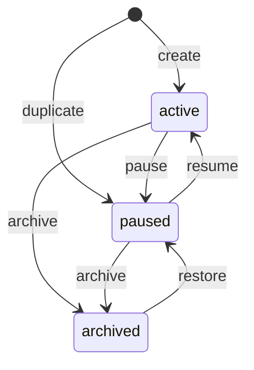

# Agent Data Model and APIs (Slice 2.1) - Plan

## Goal Capsule

- **Objective:** Workspace members can keep and manage agents, and nobody outside the workspace can see, change or detect them.
- **Product authority:** `AGENT_BUILD_GUIDE.md` Slice 2.1, then `docs/MASTER_PRD.md` AGT-1 to AGT-4 as changed by `docs/decisions/ADR-0005-agent-deletion.md`, then this plan.
- **Execution profile:** one slice on `main`, backend only, one focused security and concurrency review before push.
- **Stop conditions:** a settled decision proves unworkable, or existing Phase 1 behaviour would have to change.
- **Open blockers:** none.

---

## Product Contract

### Summary

Workspace-owned agents with a full management API, immutable configuration versions, and limits on agents, versions and write rate.
Every agent route uses the existing membership check, and the isolation matrix attacks each one automatically.

### Problem Frame

Phase 2 screens, the prompt builder, chat and knowledge all need an agent to attach to, and none exists.
The current matrix detects a route that skips the membership check.
It does not detect a guarded route that loads an agent from another workspace the caller also belongs to, and it cannot tell a real 404 from one caused by a bad test ID.

### Key Decisions

- **Version history starts in this slice.** Governs R12, R13, R14. (session-settled: user-directed — chosen over a counter only or waiting for 2.4: no lost history and no backfill.)
- **Archived agents are read-only and restore to paused.** Governs R8, R9. (session-settled: user-directed — chosen over archive that only hides, or is permanent: nothing hidden changes or starts by surprise.)
- **The model reference exists but stays empty.** Governs R5. (session-settled: user-directed — chosen over omitting it or free text: stable shape without invented models.)
- **Agents are capped per workspace.** Governs R16. (session-settled: user-directed — chosen over no cap: one member could create unlimited agents.)
- **A full version history refuses saves.** Governs R15. (session-settled: user-directed — chosen over silent pruning: rollback is planned.)
- **Agent writes are throttled per user.** Governs R17. (session-settled: user-directed — chosen over no write throttle: limits how fast versions grow.)
- **Only owners delete.** Governs R3, R10. (session-settled: user-directed — chosen over any member, as in the PRD: one member should not wipe others' work.)
- **Agent deletion cascades to conversations and executions.** Governs R11. (session-settled: user-directed — chosen over leaving it to 3.x: matches the hard-delete policy; recorded in ADR-0005.)
- **Creators are recorded on agents and versions.** Governs R6. (session-settled: user-directed — chosen over no attribution: shows who changed what.)
- **A save that changes nothing makes no version.** Governs R12, R26. (session-settled: user-directed — chosen over a version for every save: identical saves could use up the cap.)
- **Invalid requests count towards the write limit.** Governs R17. (session-settled: user-directed — chosen over counting only valid ones: stops cheap probing and spam.)
- **Writes re-check membership under a lock.** Governs R27. (session-settled: user-directed — chosen over trusting the check made when the request started.)
- **Usage rows survive agent deletion.** Governs R11. (session-settled: user-directed — chosen over cascading or deciding later: billing and abuse audits; recorded in ADR-0005.)
- **The matrix gains a positive control and a two-workspace attack.** Governs R21, R22. (session-settled: user-approved — chosen over the existing matrix alone, which misses both faults.)
- **404 comes before validation.** Governs R2. (session-settled: user-approved — chosen over validating first, which reveals that an agent exists.)

### Requirements

**Access**

- R1. Every agent route names the workspace in its path, uses the existing membership check, and finds the agent only within that workspace.
- R2. An agent outside the named workspace returns the same 404 as one that does not exist, whatever the field values, version or throttle state.
- R3. Members can list, view, create, edit, duplicate, pause, resume, archive and restore; permanent deletion is for owners, and a member who tries gets 403.

**Fields**

- R4. Name (1 to 100 characters, same character rules as workspace names, need not be unique) and instructions (1 to 10,000 characters, not only whitespace) are required; purpose and description are optional, up to 500 and 1,000 characters.
- R5. The model reference is always empty, and any non-empty value is refused with a field error until Slice 3.1.
- R6. Agents and versions record the creator's user id, returned by the API, which becomes empty when that user is deleted.
- R7. Invalid input returns field-level errors, and unknown fields are refused, including attempts to set workspace, status, creator or version number.

**Lifecycle**

- R8. Status is active, paused or archived, and changes only as the diagram below shows; any other transition is refused with a conflict and changes nothing.
- R9. The default list omits archived agents, which can be listed on request; an archived agent can be viewed, duplicated, restored or deleted (per R3) but not edited.
- R10. Deletion is permanent, allowed in any status, and re-checks under a lock that the caller is still an owner.
- R11. Deleting an agent deletes all its versions, deleting a workspace deletes its agents, and conversations and executions will follow ADR-0005.

**Versions**

- R12. A version holds name, purpose, description, instructions and model reference; creating an agent makes version 1, and every successful edit that changes something adds the next.
- R26. An edit that changes nothing returns success with the current version unchanged.
- R13. A version's configuration never changes after it is written, and a status change makes no version.
- R14. An edit states the version it started from and is refused with a conflict if that is not the current one, so of two simultaneous edits exactly one succeeds.
- R15. An agent has at most 200 versions; the next edit that changes something is refused with a clear, distinct error, nothing is pruned, and every non-edit operation still works.

**Limits**

- R16. A workspace holds at most 50 agents, archived included, configurable in settings and enforced under the lock pattern of the 20-workspace limit, so parallel creates and duplicates cannot exceed it.
- R17. Each user gets 60 create, edit and duplicate requests combined, across all workspaces, per 10 minutes, configurable and counted by the existing throttle; invalid requests count, and more returns 429.
- R27. A write re-checks membership in its own transaction with the membership row locked for share, and a removal that committed first makes it fail with 404.
- R18. Lists are paginated with a bounded page size and a stable order.

**Duplicate and run rule**

- R19. A duplicate copies only the current configuration into a new paused agent at version 1, created by the caller, named "Copy of <name>" with the original name cut so the result is at most 100 characters.
- R20. One shared rule decides whether an agent may run: only active ones may, with a clear reason otherwise.

**Proof and records**

- R21. Every matrix attack on an agent route uses a real agent of the other tenant, and the same request by someone entitled to it must not return 404.
- R22. A person in two workspaces gets 404 with no change when using one workspace's agent through the other, on every route that names an agent.
- R23. New agent routes join the matrix without being listed by hand, and a path parameter with no real object fails the suite.
- R24. Tests run parallel requests against R14, R15 and R16.
- R25. The PRD roles table and AGT-1 are updated to match ADR-0005, and `docs/DATABASE_DESIGN.md` documents the new tables and deletion behaviour.

### Acceptance Examples

- AE1. **Covers R2.** Given another tenant's agent, when an outsider sends an edit with invalid fields or an outdated version, or has used up their write allowance, then the answer is 404.
- AE2. **Covers R3.** Given a member and an owner, when each deletes an agent, then the member gets 403 and the agent remains, and the owner's delete succeeds.
- AE3. **Covers R10.** Given an owner demoted while their delete waits, when it continues, then it is refused and the agent remains.
- AE4. **Covers R14.** Given two edits from version 3, when both arrive together, then one creates version 4 and the other gets a conflict.
- AE5. **Covers R15.** Given 200 versions, when an edit that changes something arrives, then it is refused with version 200 unchanged, and pausing still works.
- AE6. **Covers R16.** Given 49 agents, some archived, when a create and a duplicate arrive together, then exactly one succeeds.
- AE7. **Covers R8, R9.** Given an archived agent, when it is edited the edit is refused, and when it is restored it becomes paused.
- AE8. **Covers R6.** Given a creator whose user row is deleted, then their agents and versions remain with an empty creator.

- AE9. **Covers R26, R15.** Given an agent at version 200, when an edit changes nothing, then it succeeds and the version is still 200.
- AE10. **Covers R27.** Given a member removed while their edit waits, when it continues, then it gets 404 and nothing changes.

### Scope Boundaries

- Deferred to 2.2 and 2.4: screens, search, version browsing and rollback.
- Deferred to 3.x: real model choices, conversations, executions, and the chat error of AGT-3. R20 is the part testable now.
- Not included: prompt builder, tools, permissions, sharing, or making the 20-workspace limit configurable.

### Dependencies / Assumptions

- The 200-version cap is a constant; only R16 and R17 must be configurable.
- Pause, resume, archive, restore and delete are outside R17.
- Lowering the agent limit below a workspace's count only blocks new agents.

### Sources / Research

- `backend/app/modules/workspaces/dependencies.py`: the membership check, and the owner check that answers members with 403.
- `backend/tests/test_tenant_isolation.py`: `b_children` needs a real agent id, `BODY` is workspace-shaped, and the "own" case supplies only `user_id`.
- `backend/app/modules/workspaces/service.py`: `_check_ownership_limit` and `_lock_owners_as_owner`, the lock patterns for R16 and R10.
- `backend/app/modules/identity/throttle.py`: `record_attempt` commits, so it must run before any lock or unsaved work. `_delete_expired` uses only the login and signup windows, so a longer configured agent window would be cut short unless it is included.
- `backend/app/main.py`: request bodies are limited to 64 KB, above the R4 maximums as normally encoded.

---

## Planning Contract

**Product Contract preservation:** changed at the owner's direction before planning: R12, R15, R17, R19 amended; R26, R27, AE9, AE10 added.

### Key Technical Decisions

- KTD1. **Configuration lives only in versions.** `agents` holds workspace, status, current version number and creator; `agent_versions` holds the R12 fields, unique on agent and number. One copy cannot disagree with another.
- KTD2. **An agent dependency nested on the membership check.** It finds the agent by id and workspace together, so dependency order gives R2: FastAPI resolves dependencies before it validates body fields. Delete looks the agent up before it checks for ownership.
- KTD3. **The throttle is a dependency that runs after access and before the handler.** Invalid bodies are therefore counted (R17). `record_attempt` commits, so no lock may be held yet. A body that is not JSON is refused by FastAPI before any dependency: not counted, same answer for everyone. (session-settled: user-approved — chosen over new middleware: the answer reveals nothing.)
- KTD4. **Every write locks in one order: workspace row (`FOR NO KEY UPDATE`), caller's membership (`FOR SHARE`), agent row (`FOR UPDATE`, reloading it).** Writes take turns per workspace. Delete uses `_lock_owners_as_owner`, which starts the same way, then the agent row. (session-settled: user-approved — chosen over locking only membership and agent, which can deadlock with a workspace delete.) Implements R10, R14, R15, R16, R27.
- KTD5. **An edit checks in this order:** archived (409), outdated version (409), no change (200), version cap (409), then save. An outdated edit is a conflict even when its text is identical. (session-settled: user-approved — chosen over comparing first.)
- KTD6. **Edits are partial.** Omitted fields stay; null or blank clears purpose and description; null name or instructions is refused. (session-settled: user-approved — chosen over full replacement.)
- KTD7. **Text allows line feeds, carriage returns and tabs but no other control characters or lone surrogates.** PostgreSQL cannot store null characters. Names use the workspace name check, moved to a shared module.
- KTD8. **Limits:** settings `agent_limit_per_workspace` (50), `agent_write_limit` (60) and `agent_write_window_minutes` (10); constant `MAX_VERSIONS` (200). Throttle cleanup uses the longest of all three windows.
- KTD9. **The positive control asserts that an entitled caller's answer is not 401, 404, 405 or 5xx.** Access is resolved before validation, so even a 422 proves the object was found, and no per-route bodies are needed.
- KTD10. **List:** `limit` 1 to 100 (default 50) and `offset`, newest first then id, with a total; `archived=true` lists only archived agents. Items omit instructions.

### Assumptions

- Creating, editing and duplicating are single-transaction, so an error leaves nothing behind.

---

## Implementation Units

### U1. Schema, models and settings

- **Goal:** store agents and versions.
- **Requirements:** R6, R8, R11, R13
- **Dependencies:** none
- **Files:** `backend/app/modules/agents/{__init__,models}.py`, `backend/app/models.py`, `backend/migrations/versions/0003_agents.py`, `backend/app/core/config.py`, `backend/.env.example`, `backend/tests/auth_helpers.py`, `backend/tests/test_migrations.py`, `backend/tests/test_schema_constraints.py`
- **Approach:** KTD1, KTD8. Cascade workspace to agent to version; `created_by` is `ON DELETE SET NULL` and indexed; check constraint on status built from one list.
- **Test scenarios:**
  - Deleting an agent removes its versions; deleting a workspace removes both.
  - Covers AE8. Deleting the creator empties `created_by` on both tables and keeps the rows.
  - An unknown status and a duplicate version number are refused by the database.
  - Upgrade, downgrade, upgrade, and no model drift.
- **Verification:** migration tests pass and `alembic check` finds nothing.

### U2. Throttle for agent writes

- **Goal:** limit writes per user.
- **Requirements:** R17
- **Dependencies:** U1
- **Files:** `backend/app/modules/identity/throttle.py`, `backend/tests/test_throttle.py`
- **Approach:** KTD3, KTD8; key on the user id.
- **Test scenarios:**
  - Request 61 is refused, another user is unaffected, and the limit lifts when the window ends.
  - With an agent window longer than the others, a login attempt does not delete rows still inside it.
- **Verification:** existing throttle tests pass unchanged.

### U3. Agent service and routes

- **Goal:** every operation of the Access, Fields, Lifecycle, Versions and Limits requirements.
- **Requirements:** R1 to R20, R26, R27
- **Dependencies:** U1, U2
- **Files:** `backend/app/modules/agents/{schemas,dependencies,service,router}.py`, `backend/app/core/text.py`, `backend/app/modules/workspaces/{schemas,service}.py`, `backend/app/main.py`, `backend/tests/test_agents_api.py`
- **Approach:** KTD2 to KTD7, KTD10. Routes sit under `/api/workspaces/{workspace_id}/agents`; duplicate, pause, resume, archive and restore are POST actions.
- **Patterns to follow:** `backend/app/modules/workspaces/`.
- **Test scenarios:**
  - Create, view, list, edit, duplicate, pause, resume, archive, restore and delete as a member (except delete) and as an owner.
  - Covers AE1. Outsider with invalid fields, an outdated version, or no allowance left gets 404.
  - Covers AE2. Member delete gets 403 and the agent remains; owner delete gets 204.
  - Member deleting an agent of another workspace gets 404, not 403.
  - Every field limit at its boundary and one past it; unknown fields; null characters; a model reference.
  - Each of the nine status and action pairs outside the diagram gets 409 with no change.
  - Covers AE7. Archived edit refused; restore gives paused.
  - Covers AE5, AE9. At 200 versions a changing edit is refused, an unchanged one gets 200, and pausing works.
  - Outdated edit with identical text gets 409.
  - Duplicate of a 100-character name, of an archived agent, and at the agent cap.
  - Invalid bodies count to the limit; status changes and delete do not; 429 after it.
  - Pages are stable and bounded; the default list omits archived agents.
  - Only an active agent passes the run rule.
- **Verification:** all scenarios pass against the real database.

### U4. Isolation matrix and races

- **Goal:** prove isolation and the concurrent rules.
- **Requirements:** R10, R14, R15, R16, R21 to R24, R27
- **Dependencies:** U3
- **Files:** `backend/tests/test_tenant_isolation.py`, `backend/tests/test_agent_concurrency.py`
- **Approach:** KTD4, KTD9. Give both tenants real agents; the two-workspace attack covers every path parameter except people (`user_id`).
- **Test scenarios:**
  - The matrix finds all agent routes and each attack uses a real agent; a list in one workspace shows none of another's.
  - Covers AE3. Owner demoted while a delete waits gets 403.
  - Covers AE4. Two edits from one version give one 200 and one 409.
  - Covers AE6. Create and duplicate at 49 give one 201 and one 409.
  - Covers AE10. A member removed while an edit waits gets 404 and nothing changes.
  - Two edits at version 199 leave exactly 200.
  - A workspace delete and an edit arriving together both finish without a deadlock.
- **Verification:** removing each guard in turn makes a test fail: workspace filter, lock, membership re-check, version check, cap.

### U5. Documents

- **Goal:** R25 and the slice log.
- **Requirements:** R11, R25
- **Dependencies:** U4
- **Files:** `docs/MASTER_PRD.md`, `docs/DATABASE_DESIGN.md`, `README.md`, `PROJECT_STATUS.md`
- **Approach:** record real results only.
- **Test expectation:** none -- documentation.
- **Verification:** documents match ADR-0005 and the code.

---

## Verification Contract

| Gate | Command (from `backend/`) |
|---|---|
| Tests with a database, zero skips | `.venv\Scripts\python -m pytest` |
| Lint and format | `ruff check .`, `ruff format --check .` |
| Migrations on the dev database | `alembic upgrade head`, `check`, `downgrade -1`, `upgrade head` |
| Guards are tested | remove each U4 guard in turn and see a failure |
| Repo gate | `/verify` right before commit |

## Definition of Done

- All units verified, every gate passes, and no abandoned code remains.
- One focused security and concurrency review after the code and before push; findings fixed or recorded.
- `PROJECT_STATUS.md` updated with real results, per `AGENT_BUILD_GUIDE.md`.
