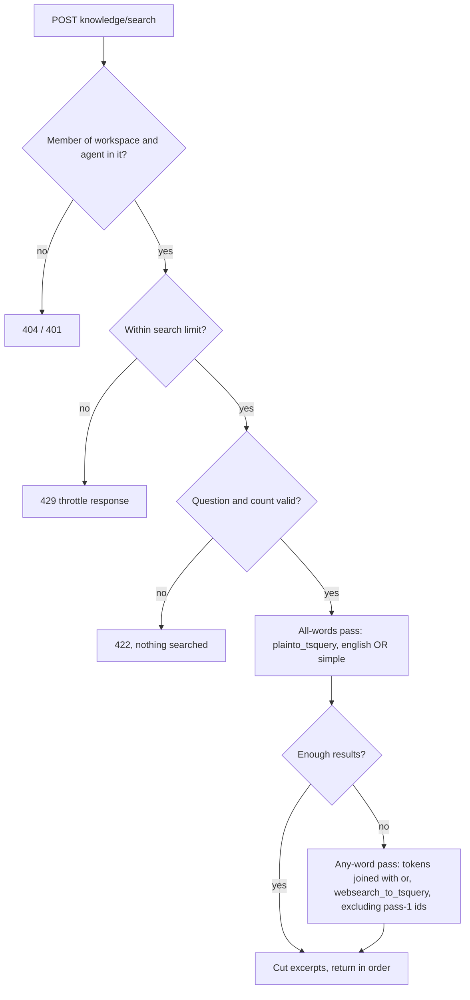

# Knowledge Retrieval - Plan

## Goal Capsule

- **Objective:** A workspace member can ask a question of one agent's uploaded knowledge and get back a short, ranked list of excerpts, each citing its document, page and position, drawn only from that agent's ready documents. Slice 4.4 can then ground chat answers without waiting for pgvector.
- **Means:** PostgreSQL full-text search behind a retrieval interface that a pgvector embedding implementation can replace later (Key Decisions; KTD1, KTD3).
- **Product authority:** The owner, in the brainstorm of 2026-11-28. `AGENT_BUILD_GUIDE.md` Slice 4.3 still applies, apart from the deltas recorded in Key Decisions. `AGENT_BUILD_GUIDE.md` governs the build loop.
- **Stop conditions:** Stop and report if a question or excerpt would reach a log, if any test shows a chunk from another workspace, another agent or a non-ready source, or if the migration would change the text of any existing chunk. The one-time table rewrite in Assumptions is allowed.
- **Execution profile:** One branch (`slice-4.3`), one change set. The owner's loop: build, chunked tests, one independent reviewer, the break-one-guard check, `/verify`, update `PROJECT_STATUS.md`, merge to `main` and push.
- **Open blockers:** None.

---

## Product Contract

Product Contract preservation: clarified, no scope change. R1 names the position field `sequence`, and R6 says which test covers which part. The three questions deferred to planning are answered by KTD2, KTD4 and KTD6.

### Summary

Retrieval goes behind one interface. Its first implementation is PostgreSQL full-text search over the chunks Slice 4.2 already writes, scoped to one workspace and one agent and limited to ready sources. A members-only search endpoint under the agent exposes it, so the tenant isolation matrix covers it. An ADR records the deviation from ADR-0002, and the pgvector switch goes on the pre-deployment list.

### Problem Frame

Slice 4.3 has been blocked since 2026-11-27. pgvector is not available on the local PostgreSQL 18.6, and installing it needs administrator rights and the Visual Studio C++ build tools. The owner will not install it now. Slice 4.4 (grounded answers) and the Phase 4 exit gate both depend on retrieval, so Phase 4 cannot move.

The risk in working around it is lock-in. If the first retrieval code shapes its callers around full-text specifics, such as raw scores or index columns, moving to embeddings later becomes a rewrite of 4.4 rather than a swap.

### Key Decisions

- **Full-text search now; pgvector stays the production target.** (session-settled: user-directed — chosen over installing pgvector locally: it needs admin rights and C++ build tools, and the owner will not install it now.) Governs R3, R14, R15, R16.
- **A members-only search endpoint, not an internal-only service.** The route-generated isolation matrix then covers it, and 4.4 and the manual checks get a real caller. (session-settled: user-approved — chosen over internal-only and owners-only: the matrix covers routes automatically.) Governs R6.
- **Result order is the contract, not the score.** Full-text ranks and embedding similarities are on different scales. (session-settled: user-approved — chosen over exposing a comparable score: callers that threshold scores would break at the switch.) Governs R2.
- **Match all words first, then fill with any-word matches.** Requiring every word returns nothing for most real questions. (session-settled: user-directed — chosen over all-words-only matching: one stray word would hide the right chunk.) Governs R7.
- **Match both stemmed English and exact words.** Users mix English with Roman Urdu, which English stemming does not know. (session-settled: user-directed — chosen over English-only matching: non-English words must still match exactly.) Governs R8.
- **Embedding-specific guide items move to the pgvector switch.** These are: recording the embedding model, version and dimensions; the dimension-matches-column test; and the missing-credentials processing status. Nothing in this slice generates embeddings. (session-settled: user-approved — chosen over building those parts now: they would have nothing to measure.) Governs R15.

### Requirements

**Retrieval interface**

- R1. One retrieval interface takes a workspace, an agent, a question and a result count. It returns ranked excerpts, each carrying the source id, source name, page (PDFs only), chunk position (`sequence`) and excerpt text.
- R2. Callers depend only on result order. No score that callers could compare or threshold is part of the interface or the endpoint response.
- R3. A pgvector embedding implementation can replace the full-text one without changing any caller or the endpoint's response shape.

**Scope and isolation**

- R4. Retrieval returns only chunks of the named workspace and agent, filtered inside the database query itself.
- R5. Only chunks of sources whose status is `ready` are returned. Deleted sources need no extra rule, because their chunks are deleted with them.
- R6. The search endpoint sits under the agent and is open to any member of the workspace. Outsiders get 404 and signed-out callers 401. A foreign or sibling agent id never reaches another agent's chunks. The tenant isolation matrix covers the access rules, and an endpoint test with real chunks covers which results come back.

**Matching**

- R7. A search first requires every question word to match. If that gives fewer results than requested, a second pass that accepts any of the same words fills the remaining places. All-words results always rank above any-word results, nothing appears twice, and each pass ranks by `ts_rank_cd`.
- R8. A chunk matches when either its English-stemmed form or its exact-word form matches the question, in both passes of R7.
- R9. User text reaches PostgreSQL only through `websearch_to_tsquery` or `plainto_tsquery`, never raw `to_tsquery`. Quotes, punctuation or search operators never cause an error. A question of only stop words or punctuation returns an empty list.

**Limits and privacy**

- R10. These limits are configurable: a question may be at most 500 characters, a search returns at most 10 results, and each excerpt is at most 1,500 characters. A request beyond the first two limits is refused, and a longer chunk is cut to the excerpt limit.
- R11. Each user may make at most 60 searches per 10 minutes (configurable). Beyond that the endpoint answers with the existing throttle response.
- R12. Question text is never logged, neither in application logs nor in error responses. Neither are excerpts.

**Schema readiness**

- R13. The search index is derived from chunk text inside the database. Chunks that already exist become searchable without reprocessing, and the document worker does not change.
- R14. The schema change adds no embedding columns now. Embeddings will get their own place when pgvector arrives, without reworking the full-text index.

**Records**

- R15. A new ADR records full-text retrieval as a deviation from ADR-0002. It names pgvector as the production target, says what changes at the switch, and lists the guide items deferred to it.
- R16. `PROJECT_STATUS.md` gains "Switch to pgvector on the production database" under "Must fix before any deployment". It also replaces the Slice 4.3 pgvector blocker with a pointer to the ADR.

### Acceptance Examples

- AE1. **Covers R7.** **Given** a ready document whose chunk says "Refunds are accepted within 30 days of purchase", **when** a member asks "what is the refund window for purchases", **then** that chunk is returned, although "window" appears nowhere in the document.
- AE2. **Covers R7.** **Given** one chunk containing every word of the question and another containing only some, **when** a member asks for 2 results, **then** the chunk with every word comes first.
- AE3. **Covers R8.** **Given** a ready chunk that contains the Roman Urdu phrase "fees kitni hai", **when** a member asks "kitni fees", **then** that chunk is returned.
- AE4. **Covers R4, R6.** **Given** a chunk with the exact question words in another tenant's agent, and another in a sibling agent of the same workspace, **when** a member searches their own agent, **then** neither chunk is returned. A request naming the other agent's id gets 404.
- AE5. **Covers R5.** **Given** sources in `pending`, `processing` and `failed` states whose chunks contain the question words, **when** a member searches, **then** none of their chunks are returned.
- AE6. **Covers R9.** **Given** the question `"refund" -OR (( ' ;`, **when** a member searches, **then** the response is a normal result list, possibly empty, never a server error. **Given** the question "the and of", **then** the response is an empty list.
- AE7. **Covers R10.** **Given** a 501-character question, or a request for 11 results, **when** a member searches, **then** the request is refused with the standard validation error and no search runs.
- AE8. **Covers R11.** **Given** a user who has searched 60 times in the last 10 minutes, **when** they search again, **then** they get the throttle response.

### Success Criteria

- Known test questions return the expected chunks, and the cross-workspace test returns zero foreign chunks (guide, Slice 4.3).
- Removing any single scoping filter or the ready-status filter makes at least one test fail (the project's break-one-guard check).

### Scope Boundaries

- No embeddings, embedding provider, or pgvector extension in this slice. All of them belong to the switch recorded by R15.
- No use of retrieval in chat. Wiring it into the agent runtime, citing sources in answers, and the no-match answer belong to Slice 4.4.
- No search screen in the frontend.
- No highlighted snippets, phrase search, reranking, or relevance thresholds.
- No decision on whether a paused or archived agent's knowledge may be used in chat. That is left to 4.4. The endpoint follows the existing agent read rules.
- Considered and not built: a per-workspace search limit next to the per-user one. Searches cost one indexed query and no provider money, so the per-user limit (R11) bounds load. A sign of abuse across many accounts in one workspace would change this.

### Dependencies / Assumptions

- Chunks already carry copies of their source's workspace and agent ids, kept equal by a foreign key, and are deleted with their source (`backend/app/modules/knowledge/models.py`).
- Chunks are about 1,200 characters (`backend/app/modules/knowledge/chunking.py`), so R10's excerpt limit rarely cuts anything today.
- The per-user throttle and its configurable limits already exist (`backend/app/modules/identity/throttle.py`, `backend/app/core/config.py`).
- The validation error handler returns only `loc`, `msg` and `type`, never the submitted value (`backend/app/core/errors.py`), which R12 relies on.

### Sources / Research

- `AGENT_BUILD_GUIDE.md` Slice 4.3 and Slice 4.4: the original task and its tests.
- `docs/decisions/ADR-0002-technology-stack.md`: the pgvector choice this slice deviates from.
- `PROJECT_STATUS.md` "Blocked / needs owner input": the pgvector install steps, kept for the switch.
- `backend/tests/test_tenant_isolation.py`: the route-generated isolation matrix (R6).
- `docs/plans/2026-11-27-1900-feat-document-processing-plan.md`: how chunks are produced.

---

## Planning Contract

### Key Technical Decisions

- KTD1. **A `Retriever` protocol with one full-text implementation, chosen by a setting.** A new `backend/app/modules/knowledge/retrieval.py` defines a small `Excerpt` value (source id, source name, page, sequence, text) and the protocol's one search method. A `get_retriever()` factory returns the full-text implementation. The router and Slice 4.4 depend only on the factory and `Excerpt`, so the pgvector switch changes only the factory, adding a setting to choose between the two once both exist (R1, R2, R3). A setting with one value was considered and left out: it would have nothing to choose.
- KTD2. **POST with a JSON body at `/api/workspaces/{workspace_id}/agents/{agent_id}/knowledge/search`.** A GET would put the question in the URL, which access logs print (R12). This is the same reasoning the upload route records for its file name in `backend/app/modules/knowledge/router.py`. The route uses `AgentInWorkspace` and `MemberContext` like the sources routes, and sends `never_cached` (R6).
- KTD3. **Two generated STORED `tsvector` columns on `knowledge_chunks`, each with a GIN index.** One is `to_tsvector('english', content)` and the other `to_tsvector('simple', content)`. They are declared in the model with `Computed(..., persisted=True)` so `alembic check` stays clean. PostgreSQL fills them for existing rows when the column is added, so nothing is reprocessed and the worker does not change (R8, R13). A later embeddings table can reference chunks by id without touching these columns (R14).
- KTD4. **Queries are built from word tokens, with English stop words removed from the exact-word half.** PostgreSQL's `simple` configuration has no stop-word list. Without this step, "the and of" would match nearly every chunk through the `simple` column, breaking R9 and AE6, and the any-word pass would fill every place with chunks that share only words like "the" or "is". The question is split into Unicode word tokens (letters and digits only), and each query is then built as follows:
  1. English all-words: the raw question goes to `plainto_tsquery('english', …)`, whose own stop-word list applies.
  2. Exact-word all-words: tokens that `to_tsvector('english', token)` reduces to nothing are dropped. That is PostgreSQL's English stop-word list, which includes `or`. The rest are joined with spaces for `plainto_tsquery('simple', …)`.
  3. Any-word, both configurations: the same filtered tokens are joined with ` or ` for `websearch_to_tsquery`.
  4. When no configuration yields a lexeme, the retriever returns an empty list without running a search.

  Tokens hold no operator characters, so the user cannot shape the query, and raw `to_tsquery` is never used (R7, R8, R9). Roman Urdu words are not English stop words, so they still match exactly (AE3). Two alternatives were rejected. Editing the text form of a tsquery fails because quoted lexemes can contain the characters being replaced. A custom configuration (simple dictionary plus English stop words) for the indexed column would change the `simple` column the owner asked for.
- KTD5. **Two bounded queries, both filtered the same way.** Each query joins chunks to their source and filters on workspace id, agent id and source status `ready` (R4, R5). It ranks by the greater of the two `ts_rank_cd` values, then by source id and sequence so the order is stable. The any-word pass excludes the chunk ids the first pass returned and asks only for the remaining count (R7). Excerpts are cut to the configured length in Python after the query (R10).
- KTD6. **Settings and defaults.** New settings: `knowledge_search_question_max_chars` = 500, `knowledge_search_max_results` = 10, `knowledge_search_default_results` = 5, `knowledge_search_excerpt_max_chars` = 1,500, `knowledge_search_limit_per_user` = 60, `knowledge_search_window_minutes` = 10 (R10, R11). The request model reads its caps from settings, so a configured lower cap is enforced at validation and no search runs (AE7). When the caller gives no count, the default of 5 applies. That is a planning choice within the cap of 10, and 4.4 may pass its own count.
- KTD7. **The throttle counts after the access check, in a dependency, like uploads.** A `search_limits(user_id)` helper in `throttle.py` and a `count_search` dependency mirror `count_upload`. Outsiders count nothing, so the matrix's "nothing changed" snapshot still holds for them, and refused searches count (R11).

### High-Level Technical Design

The search flow, from request to response:

Both passes filter on workspace, agent and ready status inside SQL (KTD5).

### Assumptions

- ADR number 0007 is next (`docs/decisions/` ends at ADR-0006).
- English is the only stemming language. Other languages match on exact words through the `simple` column (R8).
- The migration rewrites `knowledge_chunks` once while adding the stored columns. That is acceptable at development scale. A production database with many chunks would need the same migration run in a quiet window, which the ADR notes.

---

## Implementation Units

### U1. Search columns and migration

- **Goal:** Chunks carry the two derived search columns with GIN indexes, including chunks that already exist.
- **Requirements:** R8, R13, R14; KTD3.
- **Dependencies:** None.
- **Files:** `backend/app/modules/knowledge/models.py`, `backend/migrations/versions/0011_knowledge_chunk_search.py`, `backend/tests/test_migrations.py`.
- **Approach:**
  1. Add the two `Computed` `TSVECTOR` columns and two GIN indexes to `KnowledgeChunk`.
  2. Write migration 0011 to add them, with a downgrade that drops the indexes and columns.
  3. Extend the migration test the way 0010 was added.
- **Patterns to follow:** `backend/migrations/versions/0010_jobs_and_knowledge_chunks.py` (docstring states it is additive and holds private text), the 0010 entries in `backend/tests/test_migrations.py`.
- **Test scenarios:**
  - A chunk inserted before upgrading to 0011 has both columns filled after the upgrade.
  - A chunk inserted after the upgrade gets both columns without the application setting them.
  - Downgrade then upgrade leaves chunks intact and searchable.
  - `alembic check` reports no difference between models and migrations.
- **Verification:** The migration tests pass and `alembic check` is clean.

### U2. Retriever interface and full-text search

- **Goal:** One interface returns ranked, scoped excerpts using the two-pass match.
- **Requirements:** R1, R2, R3, R4, R5, R7, R8, R9, R10 (excerpt cut); KTD1, KTD4, KTD5, KTD6.
- **Dependencies:** U1.
- **Files:** `backend/app/modules/knowledge/retrieval.py` (new), `backend/app/core/config.py`, `backend/.env.example`, `backend/tests/test_retrieval.py` (new).
- **Approach:**
  1. Define `Excerpt` and the `Retriever` protocol, the full-text class and `get_retriever()`.
  2. Add the settings from KTD6.
  3. Write the token and query builder (KTD4) so its token step is a pure function, tested on its own. The stop-word check runs in PostgreSQL.
- **Execution note:** Write the scoping and ready-status tests before the queries, so every filter is proven by a failing test first.
- **Patterns to follow:** Service functions in `backend/app/modules/knowledge/service.py` that take `db` and ids. Settings fields with `Field(default=..., gt=0)` in `backend/app/core/config.py`.
- **Test scenarios:** (this seam calls the retriever on a real test database; it proves SQL behaviour but not HTTP access rules, which U3 covers)
  - Covers AE1. One missing question word still finds the chunk through the any-word pass.
  - Covers AE2. A chunk with every word ranks above a chunk with some words when 2 are requested.
  - Covers AE3. "kitni fees" finds a chunk containing "fees kitni hai".
  - English stemming: "refunded" finds a chunk containing "refunds".
  - Covers AE4. Chunks of another workspace and of a sibling agent with identical text are never returned.
  - Covers AE5. Chunks of `pending`, `processing` and `failed` sources are never returned.
  - Covers AE6. The question `"refund" -OR (( ' ;` returns a list without error.
  - Covers AE6. "the and of" returns an empty list even when a ready chunk contains all three words.
  - A question consisting only of the word "or" returns an empty list without error.
  - The any-word pass does not return a chunk that shares only stop words ("what", "is", "the") with the question.
  - Calling the retriever with workspace B's id and an agent id from workspace A, with matching text, returns an empty list. This is the test that catches removal of the workspace filter, since agent ids are unique on their own.
  - No chunk appears twice when both passes match it.
  - The result count never exceeds the requested count.
  - A chunk longer than the excerpt limit is cut to exactly that length. A shorter one is returned whole.
  - Each excerpt carries the right source id, source name, page (set for a PDF chunk, empty for text) and sequence.
  - The same query twice returns the same order.
  - `Excerpt` has no score field (R2).
  - The token step emits only letter and digit tokens and returns nothing for punctuation-only input.
- **Verification:** All retrieval tests pass against the real test database.

### U3. Search endpoint and throttle

- **Goal:** Members search an agent's knowledge over HTTP, limited and logged without content.
- **Requirements:** R6, R10, R11, R12; KTD2, KTD6, KTD7.
- **Dependencies:** U2.
- **Files:** `backend/app/modules/knowledge/router.py` (or a sibling search router in the same module), `backend/app/modules/knowledge/schemas.py`, `backend/app/modules/identity/throttle.py`, `backend/app/main.py` (only if a new router needs registering), `backend/tests/test_knowledge_search.py` (new), `backend/tests/test_tenant_isolation.py`, `backend/tests/test_route_inventory.py` (if it lists routes), `.gstack/pregate.json`.
- **Approach:**
  1. Add the request schema (`question`, optional `limit`, caps read from settings, surrounding whitespace stripped, an empty question refused) and the response schema (list of excerpts, no score).
  2. Add `search_limits` and the `count_search` dependency, ordered after the access dependencies.
  3. Add the POST route calling `get_retriever()`.
  4. Add the route to the matrix's known-endpoints floor and its nested-swap expectations for `agent_id`. Add a valid search body (for example `{"question": "refund"}`) to `VALID_BODIES`, so the nested-route positive control gets a 2xx.
  5. Add the new test files to `.gstack/pregate.json`.
- **Patterns to follow:** `count_upload`, `UploadLimitError` and `list_sources` in `backend/app/modules/knowledge/router.py`. `test_matrix_covers_the_known_endpoints` for the floor.
- **Test scenarios:** (this seam is the full app over HTTP; it proves access, limits and logging but leaves ranking to U2)
  - A member and an owner each get 200 with excerpts in rank order and no score field.
  - Covers AE4. The isolation matrix covers the route: outsider 404 with nothing changed, a foreign agent id in one's own workspace gives 404, a sibling agent's id gives 404, and signed out gives 401.
  - Covers AE7. A 501-character question gives 422, as do `limit` 0 and 11, and no retrieval runs. The request still counts towards the limit, as refused uploads do (KTD7).
  - An empty or whitespace-only question gives 422.
  - Covers AE8. The 61st search within 10 minutes gives 429 with the standard rate-limit body.
  - An outsider's request does not add a throttle event.
  - A lower configured question cap (for example 50) is enforced.
  - The question text and excerpt text appear in no log record at any level (captured from DEBUG up), including on a 422 and a 429.
  - Covers AE4. Ready chunks with identical text exist in the caller's agent, a sibling agent and another workspace's agent. A search of the caller's agent over HTTP returns only the caller's chunks and source names.
  - The response carries the no-cache headers the sources routes send.
  - GET on the search path gives 405.
- **Verification:** Endpoint tests and the full isolation matrix pass.

### U4. Records

- **Goal:** The deviation and the production switch are written down where the owner and future slices will look.
- **Requirements:** R15, R16.
- **Dependencies:** U1, U2, U3 (so the docs describe what was built).
- **Files:** `docs/decisions/ADR-0007-full-text-retrieval-before-pgvector.md` (new), `PROJECT_STATUS.md`, `docs/DATABASE_DESIGN.md`, `docs/SYSTEM_ARCHITECTURE.md`, `README.md` (only if it lists API routes or settings).
- **Approach:**
  1. In the ADR: context (pgvector unavailable locally), decision (KTD1, KTD3, KTD4), consequences, what changes at the switch (a second retriever and a setting to choose it, an embeddings table, a worker step, the deferred guide items from Key Decisions), and the one-time table rewrite note.
  2. In `PROJECT_STATUS.md`: the must-fix line, the blocker replaced by a pointer to the ADR, and the Slice 4.3 log entry with test results.
  3. In the design docs: the two columns and indexes, and the retrieval note next to the pgvector mention.
- **Test expectation:** none — documentation only.
- **Verification:** The ADR links ADR-0002, `PROJECT_STATUS.md` lists the switch under "Must fix before any deployment", and no doc still says Slice 4.3 is blocked.

---

## Verification Contract

| Check | Command (from `backend/`) | Proves |
|---|---|---|
| Retrieval and endpoint tests | `.venv\Scripts\python -m pytest tests/test_retrieval.py`, then `tests/test_knowledge_search.py` | U2, U3 behaviour |
| Isolation matrix | `.venv\Scripts\python -m pytest tests/test_tenant_isolation.py` | R6 |
| Migrations | `.venv\Scripts\python -m pytest tests/test_migrations.py` and `.venv\Scripts\alembic check` | U1 |
| Full backend suite | run in chunks, one or a few test files per process, as the owner's rules require | nothing else broke |
| Lint and format | `.venv\Scripts\ruff check .` and `.venv\Scripts\ruff format --check .` | style |
| Break-one-guard | remove one at a time: the workspace filter, the agent filter, the ready-status filter, the pass-1 exclusion, the throttle dependency, the agent access dependency | each removal fails a test |
| End-to-end | upload a text fixture through the API, run `python -m app.worker` once, then search it over HTTP | the real worker and route together |
| `/verify` | gstack `/verify` (uses `scripts/run_tests.py` and `.gstack/pregate.json`) | the ship gate |

No real Gemini calls are needed or allowed in this slice.

## Definition of Done

- Every unit's verification holds, and every test scenario above exists and passes.
- One independent reviewer has read the change, and every P0 to P2 finding is fixed or recorded with a reason in `PROJECT_STATUS.md`.
- Each guard in the break-one-guard row is caught by a test, or a surviving one is explained.
- `/verify` reports ready to ship.
- `PROJECT_STATUS.md` is updated, the branch is merged into `main` and pushed, and the merged branch is deleted.
- No abandoned experiments, debug output or unused code remain in the diff. No leftover Python or Node processes are running.
